# 題目抽驗清單

每一題請看：①答案對不對 ②干擾項是不是真的會有學生選（對應的迷思合理嗎）③三段提示有沒有一段一段來、第 1 段沒有洩漏答案 ④詳解有沒有說清楚為什麼對、其他為什麼錯 ⑤題幹長度和用字六年級讀得懂嗎。
有要改的，在題號後面寫下來就好（例如「L03-Q4：干擾項 C 太明顯」）。

## L07

### L07-Q1　圓周率的意義

**題目**：關於圓周率，下列哪一個說法正確？

**正解**：任何一個圓，圓周長除以直徑都大約是 3.14

**干擾項**

- 圓愈大，圓周率就愈大　←　以為大圓的圓周率比較大
- 圓周率是圓周長除以半徑　←　用半徑去除（那樣會得到大約 6.28）
- 圓周率是直徑除以圓周長　←　除的順序弄反了

**提示**

1. 圓周率是用圓周長和直徑算出來的，先想想是誰除以誰。
2. 量很多個大小不同的圓，把圓周長除以直徑，會發現每次的商都差不多。
3. 圓周長大約是直徑的 3.14 倍；大圓、小圓都一樣。

**詳解**：圓周率是圓周長÷直徑。不管圓有多大，圓周長大約都是直徑的 3.14 倍，所以圓周率大約是 3.14，和圓的大小無關。用半徑去除會得到大約 6.28；直徑÷圓周長會得到比 1 小的數，都不是圓周率。

驗算提示：直徑 10 公分的圓，圓周長大約是 31.4 公分，31.4÷10＝3.14。

**驗證**：概念判斷題，請人工確認：圓周率＝圓周長÷直徑，約 3.14，與圓的大小無關（另外驗算了干擾項和詳解裡的 2 個算式）

---

### L07-Q2　已知直徑求圓周長

**題目**：一個圓形時鐘的直徑是 30 公分，圓周長大約是幾公分？

**正解**：約 94.2 公分

**干擾項**

- 約 188.4 公分　←　直徑×3.14 之後又乘以 2
- 約 47.1 公分　←　把直徑除以 2，用半徑×3.14
- 約 706.5 公分　←　和圓面積公式混淆（15×15×3.14）

**提示**

1. 已知直徑，要求圓周長。
2. 圓周長＝直徑×圓周率，圓周率用 3.14。
3. 30×3.14＝？

**詳解**：圓周長＝直徑×圓周率＝30×3.14＝94.2，大約是 94.2 公分。188.4 是直徑×3.14 之後又乘了 2（直徑已經是半徑的 2 倍，不用再乘）；47.1 是把直徑除以 2，用半徑×3.14；706.5 是算成圓面積（15×15×3.14），而且面積的單位應該是平方公分。

驗算提示：圓周長大約是直徑的 3 倍多一點：30×3＝90，94.2 比 90 多一點，合理。

**驗證**：程式重算：30*3.14 ＝ 94.2（另外驗算了干擾項和詳解裡的 3 個算式）

---

### L07-Q3　已知半徑求圓周長

**題目**：一個圓形花圃的半徑是 4 公尺。繞花圃走一圈，大約是幾公尺？

**正解**：約 25.12 公尺

**干擾項**

- 約 12.56 公尺　←　忘了乘以 2，直接用半徑×3.14
- 約 50.24 公尺　←　和圓面積公式混淆（4×4×3.14）
- 約 6.28 公尺　←　把直徑算成半徑的一半（2 公尺）

**提示**

1. 繞一圈的長度就是圓周長。題目給的是半徑，不是直徑。
2. 直徑是半徑的 2 倍；圓周長＝直徑×3.14。
3. 直徑＝4×2＝8 公尺，再算 8×3.14。

**詳解**：繞一圈的長度是圓周長。題目給的是半徑 4 公尺，直徑是 4×2＝8 公尺，圓周長＝8×3.14＝25.12，大約是 25.12 公尺。12.56 是忘了乘以 2，直接用半徑×3.14；50.24 是算成圓面積（4×4×3.14）；6.28 是把直徑算成半徑的一半。

驗算提示：圓周長大約是半徑的 6 倍多一點：4×6＝24，25.12 合理。

**驗證**：程式重算：4*2*3.14 ＝ 25.12（另外驗算了干擾項和詳解裡的 3 個算式）

---

### L07-Q4　已知圓周長求半徑

**題目**：一個圓形鐵環的圓周長是 125.6 公分。這個鐵環的半徑大約是幾公分？

**正解**：約 20 公分

**干擾項**

- 約 40 公分　←　算出直徑之後，忘了再除以 2
- 約 80 公分　←　半徑和直徑的關係弄反，把直徑乘以 2
- 約 62.8 公分　←　直接把圓周長除以 2，忘了除以圓周率

**提示**

1. 已知圓周長，要倒回去先求直徑，再求半徑。
2. 圓周長＝直徑×3.14，所以直徑＝圓周長÷3.14。
3. 125.6÷3.14＝40，這是直徑；半徑還要再怎麼算？

**詳解**：圓周長＝直徑×3.14，倒回來就是直徑＝圓周長÷3.14＝125.6÷3.14＝40 公分；半徑是直徑的一半，40÷2＝20，大約是 20 公分。40 公分是直徑，忘了再除以 2；80 公分是把直徑乘以 2，半徑和直徑的關係弄反了；62.8 公分是直接把圓周長除以 2，忘了除以圓周率。

驗算提示：半徑 20 公分，圓周長＝20×2×3.14＝125.6 公分，和題目一樣。

**驗證**：程式重算：125.6/3.14/2 ＝ 20（另外驗算了干擾項和詳解裡的 4 個算式）

---

### L07-Q5　直徑的倍數和圓周長的倍數

**題目**：大圓的直徑是小圓的 3 倍。大圓的圓周長是小圓的幾倍？

**正解**：3 倍

**干擾項**

- 9 倍　←　和圓面積混淆，以為要乘兩次（3×3）
- 6 倍　←　以為圓周長有乘 2，倍數也要再乘 2
- 9.42 倍　←　把 3×3.14 算成倍數，那其實是直徑 3 的圓的圓周長

**提示**

1. 圓周長＝直徑×3.14，兩個圓都用這個公式。
2. 假設小圓的直徑是 1 公分，大圓就是 3 公分，分別算出圓周長。
3. 小圓 1×3.14，大圓 3×3.14，大圓是小圓的幾倍？

**詳解**：圓周長＝直徑×3.14，直徑變成 3 倍，圓周長也變成 3 倍。例如小圓直徑 1 公分，圓周長約 3.14 公分；大圓直徑 3 公分，圓周長約 9.42 公分，9.42÷3.14＝3。9 倍是把圓周長和圓面積混在一起（直徑變 3 倍時，面積才會變成 3×3＝9 倍）；6 倍是又多乘了 2；9.42 是直徑 3 公分的圓的圓周長，不是倍數。

驗算提示：再換一組試試看：小圓直徑 2 公分、大圓 6 公分，（6×3.14）÷（2×3.14）＝3。

**驗證**：程式重算：(3*3.14)/(1*3.14) ＝ 3（另外驗算了干擾項和詳解裡的 3 個算式）

---

### L07-Q6　素養：生活情境（輪子滾一圈前進的距離）

**題目**：體育老師用「滾輪測距器」量跑道的長度：測距器的輪子直徑是 32 公分，輪子滾一圈，測距器就前進輪子一圈的長度。老師推著它，輪子剛好滾了 50 圈。老師推的距離大約是幾公尺？

**正解**：約 50.24 公尺

**干擾項**

- 約 25.12 公尺　←　把直徑除以 2，用半徑×3.14 算一圈的長度
- 約 5024 公尺　←　算出來是公分，沒有換成公尺
- 約 16 公尺　←　以為輪子滾一圈只前進一個直徑（32×50＝1600 公分）

**提示**

1. 先讀題：輪子滾一圈前進的距離，就是輪子的圓周長；一共滾了 50 圈。
2. 一圈＝直徑×3.14，50 圈就再乘以 50。最後答案要用公尺。
3. 32×3.14＝100.48 公分，100.48×50＝5024 公分，再換成公尺。

**詳解**：輪子滾一圈，前進的距離是輪子的圓周長：32×3.14＝100.48 公分。滾 50 圈是 100.48×50＝5024 公分；1 公尺＝100 公分，5024 公分＝50.24 公尺，大約是 50.24 公尺。25.12 公尺是用半徑 16 公分×3.14，少乘了 2；5024 公尺是公分沒有換成公尺；16 公尺是以為滾一圈只前進一個直徑。

驗算提示：一圈大約 1 公尺（100.48 公分），50 圈大約 50 公尺，答案合理。

**驗證**：程式重算：32*3.14*50/100 ＝ 50.24（另外驗算了干擾項和詳解裡的 4 個算式）

---

### L07-Q7　素養：附件題（量測紀錄，找出量錯的一筆）

**附件**
| 物品 | 直徑 | 量到的圓周長 |
|---|---|---|
| 杯蓋 | 8 公分 | 25.1 公分 |
| 盤子 | 20 公分 | 62.9 公分 |
| 呼拉圈 | 70 公分 | 219.6 公分 |
| 鍋蓋 | 25 公分 | 39.3 公分 |

**題目**：上表是數學小組量四個圓形物品的紀錄。其中有一筆量錯了，是哪一個？

**正解**：鍋蓋，圓周長÷直徑只有大約 1.57，差太多了

**干擾項**

- 杯蓋，因為 25.1÷8 不是剛好 3.14　←　以為量出來一定要剛好 3.14；其實實際量測有誤差，3.13、3.15 都算對
- 盤子，因為 62.9÷20 超過了 3.14　←　以為超過 3.14 一點點就是量錯
- 呼拉圈，因為它的圓周長最長　←　只看數字大小，沒有算圓周長和直徑的關係

**提示**

1. 先讀表格：每一筆都有直徑和量到的圓周長。量得準的話，圓周長÷直徑應該大約是多少？
2. 把每一筆的圓周長除以直徑；大約 3.14 都算量對了，3.13、3.15 也可以。
3. 算算看：25.1÷8、62.9÷20、219.6÷70、39.3÷25，哪一個差最多？

**詳解**：量得準的話，圓周長÷直徑大約是 3.14；實際量測多少會有誤差，3.13、3.15 都可以接受。杯蓋：25.1÷8≒3.14；盤子：62.9÷20≒3.15；呼拉圈：219.6÷70≒3.14；鍋蓋：39.3÷25≒1.57，只有一半左右，可能只量了半圈，所以鍋蓋量錯了。杯蓋和盤子只差一點點，是量測的誤差；呼拉圈的圓周長最長，是因為它最大，不是量錯。

驗算提示：直徑 25 公分的鍋蓋，圓周長應該大約是 25×3.14＝78.5 公分，39.3 公分只有一半左右。

**驗證**：概念判斷題，請人工確認：四筆的圓周長÷直徑：3.14、3.15、3.14、1.57，只有鍋蓋差很多（另外驗算了干擾項和詳解裡的 5 個算式）

---

## L08

### L08-Q1　圓面積公式的由來

**附件**

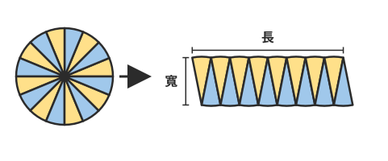

**題目**：把一個圓切成很多一樣大的小扇形，交錯排成像上圖右邊那樣、接近長方形的圖形。這個長方形的長和寬，分別相當於圓的什麼？

**正解**：長是圓周長的一半，寬是半徑

**干擾項**

- 長是整個圓周長，寬是半徑　←　沒注意圓周被分到上下兩條邊，把長當成整個圓周長
- 長是圓周長的一半，寬是直徑　←　寬當成直徑；每一小塊扇形的邊其實是半徑
- 長是直徑，寬是半徑　←　以為長方形的長是直徑，和圓周沒有關係

**提示**

1. 看圖：拼好的圖形，上面和下面的邊都是由圓周的小弧拼成的。
2. 圓周被平分到上下兩條邊，所以上面那一條邊只用了圓周的一部分。寬是每一小塊扇形的哪一條邊？
3. 上下兩條邊合起來才是整個圓周，所以長是圓周長的幾分之幾？寬是從圓心到圓周的長度。

**詳解**：圓切成很多等份後，一半的小扇形朝上、一半朝下交錯拼起來。整個圓周被分到上下兩條邊，所以長相當於圓周長的一半；寬是每一小塊扇形從圓心到圓周的邊，也就是半徑。長方形面積＝長×寬＝（圓周長÷2）×半徑＝（直徑×3.14÷2）×半徑＝半徑×半徑×3.14，這就是圓面積公式。長當成整個圓周長，面積會多一倍；寬當成直徑也會多一倍；長是直徑就和圓周沒有關係了。

驗算提示：半徑 1 公分的圓，用長×寬算：（2×3.14÷2）×1＝3.14，和公式 1×1×3.14 一樣。

**驗證**：概念判斷題，請人工確認：切割拼成近似長方形：長＝圓周長÷2，寬＝半徑，面積＝半徑×半徑×圓周率（另外驗算了干擾項和詳解裡的 2 個算式）

---

### L08-Q2　已知半徑求圓面積

**題目**：半徑 5 公分的圓，面積大約是幾平方公分？

**正解**：約 78.5 平方公分

**干擾項**

- 約 31.4 平方公分　←　和圓周長公式混淆（5×2×3.14）
- 約 314 平方公分　←　把半徑乘以 2 當成半徑代入（10×10×3.14）
- 約 15.7 平方公分　←　半徑只乘了一次（5×3.14）

**提示**

1. 求圓面積要用圓面積公式，不是圓周長公式。
2. 圓面積＝半徑×半徑×圓周率。
3. 5×5×3.14＝？

**詳解**：圓面積＝半徑×半徑×3.14＝5×5×3.14＝78.5，大約是 78.5 平方公分。31.4 是算成圓周長（5×2×3.14），單位也應該是公分；314 是用 10 公分去算（10×10×3.14），多算了 4 倍；15.7 是半徑只乘了一次。

驗算提示：圓面積大約是半徑×半徑×3：5×5×3＝75，78.5 比 75 多一點，合理。

**驗證**：程式重算：5*5*3.14 ＝ 78.5（另外驗算了干擾項和詳解裡的 4 個算式）

---

### L08-Q3　已知直徑求圓面積

**題目**：一個圓形水池的直徑是 12 公尺。水池的水面面積大約是幾平方公尺？

**正解**：約 113.04 平方公尺

**干擾項**

- 約 452.16 平方公尺　←　直接用直徑×直徑×3.14，多算了 4 倍
- 約 37.68 平方公尺　←　算成圓周長（12×3.14）
- 約 226.08 平方公尺　←　用直徑×半徑×3.14，多算了 2 倍

**提示**

1. 題目給的是直徑，圓面積公式用的是半徑。
2. 半徑＝直徑÷2＝6 公尺。
3. 6×6×3.14＝？

**詳解**：圓面積要用半徑：半徑＝12÷2＝6 公尺，面積＝6×6×3.14＝113.04，大約是 113.04 平方公尺。452.16 是直接用直徑×直徑×3.14，多算了 4 倍；37.68 是算成圓周長；226.08 是用直徑×半徑×3.14，多算了 2 倍。

驗算提示：6×6×3＝108，113.04 比 108 多一點，合理。

**驗證**：程式重算：6*6*3.14 ＝ 113.04（另外驗算了干擾項和詳解裡的 4 個算式）

---

### L08-Q4　半徑變幾倍，圓周長和圓面積各變幾倍

**題目**：一個圓的半徑變成原來的 2 倍。這個圓的圓周長和圓面積，各變成原來的幾倍？

**正解**：圓周長變 2 倍，圓面積變 4 倍

**干擾項**

- 圓周長變 2 倍，圓面積也變 2 倍　←　以為面積也只變 2 倍
- 圓周長變 4 倍，圓面積也變 4 倍　←　以為兩個都要乘兩次
- 圓周長變 4 倍，圓面積變 2 倍　←　分不清楚哪一個公式乘了兩次半徑

**提示**

1. 找一個半徑試試看：例如原來半徑 1 公分，變成 2 公分。
2. 分別算出兩個圓的圓周長（半徑×2×3.14）和圓面積（半徑×半徑×3.14）。
3. 圓周長：2×2×3.14 和 1×2×3.14 比；圓面積：2×2×3.14 和 1×1×3.14 比。

**詳解**：例如半徑 1 公分變成 2 公分：圓周長從 1×2×3.14＝6.28 變成 2×2×3.14＝12.56，是 2 倍；圓面積從 1×1×3.14＝3.14 變成 2×2×3.14＝12.56，是 4 倍。圓周長只乘了一次半徑，所以跟著變 2 倍；圓面積乘了兩次半徑，所以變 2×2＝4 倍。以為面積也只變 2 倍，是把面積當成和長度一樣；說圓周長變 4 倍，是沒分清楚哪一個公式乘了兩次半徑。

驗算提示：再用半徑 3 公分試一次：圓面積 3×3×3.14＝28.26，是 3.14 的 9 倍，也就是半徑的 3 倍再 3 倍。

**驗證**：概念判斷題，請人工確認：圓周長與半徑成正比（2 倍）；圓面積與半徑×半徑成正比（4 倍）（另外驗算了干擾項和詳解裡的 6 個算式）

---

### L08-Q5　複合圖形（正方形扣掉裡面最大的圓）

**附件**

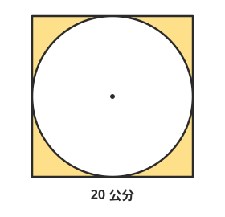

**題目**：上圖是邊長 20 公分的正方形，裡面畫了一個最大的圓。塗色部分（正方形裡、圓外面的部分）的面積大約是幾平方公分？

**正解**：約 86 平方公分

**干擾項**

- 約 314 平方公分　←　只算了圓的面積，忘了用正方形去減
- 約 337.2 平方公分　←　減掉的是圓周長（20×3.14），長度不能和面積相減
- 約 1256 平方公分　←　把正方形的邊長 20 公分當成圓的半徑

**提示**

1. 塗色部分＝正方形的面積－圓的面積。
2. 正方形裡最大的圓，直徑剛好等於正方形的邊長。
3. 正方形 20×20＝400；圓的半徑是 20÷2＝10，面積是 10×10×3.14。

**詳解**：塗色部分是正方形扣掉圓的部分。正方形面積＝20×20＝400 平方公分。正方形裡最大的圓，直徑等於邊長 20 公分，半徑是 10 公分，圓面積＝10×10×3.14＝314 平方公分。塗色部分＝400－314＝86，大約是 86 平方公分。314 只算了圓，忘了用正方形去減；337.2 是減掉了圓周長（20×3.14＝62.8），長度不能和面積相減；1256 是把邊長 20 公分當成半徑算出來的圓面積。

驗算提示：四個角落的塗色部分加起來比圓小很多，86 比 314 小很多，合理。

**驗證**：程式重算：20*20-10*10*3.14 ＝ 86（另外驗算了干擾項和詳解裡的 4 個算式）

---

### L08-Q6　素養：生活情境（灑水器噴得到的範圍）

**題目**：校園的大草皮中央裝了一個旋轉灑水器。它轉一圈時，水最遠可以噴到 7 公尺，噴到的地方剛好是一個圓形。這個灑水器一次可以澆到的草地大約是多少？

**正解**：約 153.86 平方公尺

**干擾項**

- 約 43.96 平方公尺　←　用成圓周長公式（7×2×3.14）
- 約 615.44 平方公尺　←　把 7 公尺又乘以 2 當成半徑代入（14×14×3.14）
- 約 153.86 公尺　←　數字對了，但面積的單位寫成長度的單位

**提示**

1. 先讀題：噴到的範圍是一個圓，「水最遠噴到 7 公尺」是這個圓的哪一部分？
2. 從灑水器（圓心）到最遠的地方是半徑 7 公尺；求的是草地的面積。
3. 圓面積＝7×7×3.14，單位是平方公尺。

**詳解**：灑水器在圓心，水最遠噴到 7 公尺，所以半徑是 7 公尺。澆到的草地是圓面積：7×7×3.14＝153.86，大約是 153.86 平方公尺。43.96 是算成圓周長（7×2×3.14）；615.44 是把 7 公尺又乘以 2 當成半徑；153.86 公尺的數字對了，但面積的單位要用平方公尺。

驗算提示：7×7×3＝147，153.86 比 147 多一點，合理。

**驗證**：程式重算：7*7*3.14 ＝ 153.86（另外驗算了干擾項和詳解裡的 3 個算式）

---

### L08-Q7　素養：附件題（圓周長和圓面積的對照表）

**附件**
| 半徑（公分） | 圓周長（公分） | 圓面積（平方公分） |
|---|---|---|
| 1 | 6.28 | 3.14 |
| 2 | 12.56 | 12.56 |
| 3 | 18.84 | 28.26 |
| 4 | 25.12 | 50.24 |

**題目**：上表是半徑 1～4 公分的圓的圓周長和圓面積（圓周率用 3.14）。下面哪一個說法正確？

**正解**：半徑變成 4 倍，圓面積會變成 16 倍

**干擾項**

- 半徑 2 公分時，圓周長和圓面積一樣大　←　只看數字相同；圓周長是長度、圓面積是面積，單位不同，不能比大小
- 半徑變成 2 倍，圓面積也只變成 2 倍　←　以為面積的倍數和半徑一樣
- 半徑每多 1 公分，圓面積就多 3.14 平方公分　←　以為面積是固定增加的，沒有實際用表格的數相減

**提示**

1. 先讀表格：同一列的三個數是同一個圓。注意圓周長和圓面積的單位不一樣。
2. 比較倍數：拿半徑 1 公分的圓和其他的圓比，圓面積變成幾倍？
3. 50.24÷3.14＝？半徑從 1 變成 4，是 4 倍。

**詳解**：半徑 1 公分的圓面積是 3.14 平方公分，半徑 4 公分是 50.24 平方公分，50.24÷3.14＝16，半徑變 4 倍，圓面積變 4×4＝16 倍，這句正確。半徑 2 公分時兩個數字都是 12.56，但一個是公分、一個是平方公分，長度和面積不能比大小；半徑變 2 倍時，圓面積是 12.56÷3.14＝4 倍，不是 2 倍；半徑每多 1 公分，圓面積多的都不一樣（多 9.42、15.7、21.98），不是固定多 3.14。

驗算提示：圓周長才是半徑變幾倍就變幾倍：25.12÷6.28＝4。

**驗證**：概念判斷題，請人工確認：表中 50.24÷3.14＝16（半徑 4 倍、面積 16 倍）；周長與面積單位不同不能比；面積增加量不固定（另外驗算了干擾項和詳解裡的 13 個算式）

---

## L09

### L09-Q1　用比表示兩個數量的關係

**題目**：書架上有 7 本故事書和 5 本漫畫。故事書和漫畫本數的比，要怎麼記？

**正解**：7：5

**干擾項**

- 5：7　←　前項、後項順序寫反，變成漫畫和故事書的比
- 7：12　←　後項用了全部的本數，沒有照題目比漫畫
- 7/5　←　把比寫成比值；比值是一個數，和比的寫法不一樣

**提示**

1. 「甲和乙的比」要照題目說的順序寫：先寫甲，再寫乙。
2. 比的記法是「前項：後項」，中間用「：」。
3. 故事書是 7 本，寫在前面；漫畫是 5 本，寫在後面。

**詳解**：「故事書和漫畫本數的比」，故事書寫在前面、漫畫寫在後面，記成 7：5。5：7 是順序寫反了，變成漫畫和故事書的比；7：12 的後項 12 是全部的本數，題目要比的是漫畫，不是全部；7/5 是比值，比值是一個數，和比的寫法不一樣。

驗算提示：念一次「故事書 7 本比漫畫 5 本」，和寫出來的順序一樣就對了。

**驗證**：概念判斷題，請人工確認：故事書：漫畫＝7：5（另外驗算了干擾項和詳解裡的 1 個算式）

---

### L09-Q2　認識前項和後項

**題目**：在 9：4 這個比裡，前項是哪一個數？

**正解**：9

**干擾項**

- 4　←　前項、後項弄反
- 9/4　←　把比值當成前項
- 13　←　把前項和後項加起來

**提示**

1. 一個比寫成「□：△」，「：」的兩邊各有一個數。
2. 前面的數叫前項，後面的數叫後項。
3. 看看 9：4 裡，「：」的左邊是哪一個數？

**詳解**：比寫成「前項：後項」，在 9：4 裡，9 在「：」的前面，是前項；4 在後面，是後項。說 4 是前項，是把前後弄反了；9/4 是這個比的比值（前項÷後項），不是前項；13 是前項和後項相加，沒有意義。

驗算提示：比值＝前項÷後項＝9÷4＝9/4，前項 9 正好在比值的分子。

**驗證**：概念判斷題，請人工確認：9：4 的前項是 9、後項是 4（另外驗算了干擾項和詳解裡的 2 個算式）

---

### L09-Q3　求比值

**題目**：18：24 的比值是多少？

**正解**：3/4

**干擾項**

- 4/3　←　用後項÷前項，順序反了
- 3：4　←　寫成相等的比，比是兩個數的關係，不是比值
- 6　←　用減法（24－18），比值要用除法

**提示**

1. 比值是前項除以後項的商。
2. 18：24 的前項是 18、後項是 24：比值＝18÷24。
3. 18÷24 寫成分數是 18/24，再約成最簡分數。

**詳解**：比值＝前項÷後項＝18÷24＝18/24＝3/4。4/3 是用後項÷前項，順序反了；3：4 是和 18：24 相等的比，是一個比，不是比值；6 是 24－18，比值要用除法。

驗算提示：比值 3/4×後項 24＝18，等於前項。

**驗證**：程式重算：18/24 ＝ 3/4（另外驗算了干擾項和詳解裡的 3 個算式）

---

### L09-Q4　比和比值的區別

**題目**：關於比和比值，下列哪一個說法正確？

**正解**：比是表示兩個數量的關係，比值是一個數

**干擾項**

- 比和比值是一樣的東西，只是寫法不同　←　以為比就是比值
- 5：8 的比值，要寫成 5：8　←　把比值寫成比的樣子
- 比值只能寫成整數或小數，不能寫成分數　←　不知道比值可以用分數表示，而且常用假分數

**提示**

1. 想一想：「3：5」是一個數嗎？「3÷5 的商」是一個數嗎？
2. 比是用「前項：後項」表示兩個數量的關係；比值是前項÷後項算出來的商。
3. 比值是一個數，可以寫成分數、小數或整數。

**詳解**：比是表示兩個數量關係的寫法，例如 5：8；比值是前項÷後項算出來的商，例如 5：8 的比值是 5/8，是一個數。所以比和比值不一樣；5：8 的比值要寫成 5/8（或 0.625），不能寫成 5：8；比值可以用分數表示，而且常用假分數，比較容易看出前項和後項。

驗算提示：5/8＝5÷8＝0.625，比值是一個可以拿來比大小的數。

**驗證**：概念判斷題，請人工確認：比表示關係，比值＝前項÷後項是一個數；比值可用分數表示（另外驗算了干擾項和詳解裡的 1 個算式）

---

### L09-Q5　前後項顛倒，比值的分子、分母也顛倒

**題目**：4：9 和 9：4 這兩個比的比值，有什麼關係？

**正解**：比值是 4/9 和 9/4，分子和分母剛好顛倒

**干擾項**

- 比值一樣，因為都是用 4 和 9 這兩個數　←　以為前後項的順序不影響比值
- 9：4 的比值是 5　←　用減法（9－4）算比值
- 9：4 的比值也是 4/9　←　用後項÷前項算 9：4 的比值

**提示**

1. 分別算出兩個比的比值：比值＝前項÷後項。
2. 4：9 的比值是 4÷9；9：4 的比值是 9÷4。
3. 把兩個比值寫成分數，比一比分子和分母。

**詳解**：4：9 的比值＝4÷9＝4/9，9：4 的比值＝9÷4＝9/4。前項和後項顛倒，比值的分子和分母也剛好顛倒。兩個比值不一樣（4/9 比 1 小，9/4 比 1 大），所以順序很重要；5 是 9－4，比值要用除法；說 9：4 的比值也是 4/9，是用了後項÷前項。

驗算提示：4/9×9/4＝1，顛倒的兩個比值相乘剛好是 1。

**驗證**：概念判斷題，請人工確認：4：9 比值 4/9，9：4 比值 9/4，互為倒數（另外驗算了干擾項和詳解裡的 4 個算式）

---

### L09-Q6　素養：生活情境（調飲料的用量比）

**題目**：天氣熱，阿哲調了一壺蜂蜜檸檬水給社團的同學喝。他先倒進 120 毫升的檸檬原汁，再加入 600 毫升的冷開水攪拌均勻（蜂蜜很少，先不算）。檸檬原汁對冷開水的用量比是多少？比值是多少？

**正解**：120：600，比值是 1/5

**干擾項**

- 600：120，比值是 5　←　「甲對乙」的順序讀反了
- 120：720，比值是 1/6　←　後項用了全部的量（120＋600），拿部分和全部比
- 120：600，比值是 5　←　比寫對了，比值卻用後項÷前項

**提示**

1. 先讀題：題目要的是「檸檬原汁對冷開水」，所以原汁寫在前面。
2. 比是 120：600；比值是前項÷後項＝120÷600。
3. 120÷600 寫成分數 120/600，再約成最簡分數。

**詳解**：「檸檬原汁對冷開水」的用量比，原汁寫在前面：120：600。比值＝前項÷後項＝120÷600＝120/600＝1/5。600：120 是順序讀反了；120：720 的後項是全部的量（120＋600），題目要比的是冷開水；比值 5 是用了後項÷前項。

驗算提示：比值 1/5 表示原汁是冷開水的 1/5：600×1/5＝120，對了。

**驗證**：程式重算：120/600 ＝ 1/5（另外驗算了干擾項和詳解裡的 4 個算式）

---

### L09-Q7　素養：附件題（社團人數表，寫出比和比值）

**附件**
| 社團 | 男生（人） | 女生（人） |
|---|---|---|
| 桌球社 | 12 | 8 |
| 合唱團 | 6 | 15 |
| 科學社 | 10 | 9 |

**題目**：上表是六年級三個社團的人數。合唱團「女生人數對男生人數」的比和比值，下面哪一個正確？

**正解**：15：6，比值是 5/2

**干擾項**

- 6：15，比值是 2/5　←　順序反了，變成男生對女生
- 15：21，比值是 5/7　←　後項用了合唱團全部的人數
- 12：8，比值是 3/2　←　表格看錯列，看成桌球社

**提示**

1. 先讀表格：找到「合唱團」那一列，再看題目要的是「女生對男生」。
2. 女生寫在前面、男生寫在後面；比值＝前項÷後項。
3. 合唱團女生 15 人、男生 6 人：比是 15：6，比值是 15÷6，記得約分。

**詳解**：合唱團女生 15 人、男生 6 人，「女生人數對男生人數」記成 15：6，比值＝15÷6＝15/6＝5/2。6：15 是順序反了（男生對女生）；15：21 的後項 21 是合唱團全部的人數，不是男生；12：8 是看到桌球社那一列了。

驗算提示：比值 5/2 表示女生是男生的 5/2 倍：6×5/2＝15，對了。

**驗證**：程式重算：15/6 ＝ 5/2（另外驗算了干擾項和詳解裡的 5 個算式）

---

## L10

### L10-Q1　判斷相等的比

**題目**：下面哪一個比和 3：5 是相等的比？

**正解**：12：20

**干擾項**

- 5：7　←　以為前項、後項同加一個數（＋2）也會相等
- 1：3　←　以為前項、後項同減一個數（－2）也會相等
- 6：15　←　前項和後項乘的數不一樣（前項×2、後項×3）

**提示**

1. 相等的比，比值會一樣。先算出 3：5 的比值。
2. 也可以看前項和後項是不是同乘以（或同除以）同一個不等於 0 的數。
3. 3×4＝12、5×4＝20；其他的選項是同加、同減，還是乘的數不一樣？

**詳解**：3：5 的前項和後項同乘以 4，得到 12：20，所以 3：5＝12：20；比值也一樣：3/5＝12/20。5：7 是前後項同加 2，比值變成 5/7，不相等；1：3 是同減 2，比值 1/3，不相等；6：15 是前項乘以 2、後項乘以 3，乘的數不一樣，比值 2/5，也不相等。

驗算提示：比值 12÷20＝3/5，和 3÷5 一樣。

**驗證**：概念判斷題，請人工確認：12：20 的比值 3/5 與 3：5 相同；5：7、1：3、6：15 的比值不同（另外驗算了干擾項和詳解裡的 4 個算式）

---

### L10-Q2　用同乘求相等的比

**題目**：4：9＝□：45，□ 是多少？

**正解**：20

**干擾項**

- 40　←　以為前項、後項同加一個數（9＋36＝45，4＋36＝40）
- 4　←　只把後項乘了，前項沒有跟著乘
- 5　←　把乘的倍數當成答案

**提示**

1. 相等的比：前項和後項要同乘以（或同除以）同一個數。
2. 後項從 9 變成 45，是乘以幾？
3. 9×5＝45，前項 4 也要乘以 5。

**詳解**：後項從 9 變成 45，是乘以 5（45÷9＝5），前項也要乘以 5：4×5＝20，所以 4：9＝20：45。40 是以為前後項同加一個數，同加不會得到相等的比；4 是只乘了後項，前項沒變；5 是乘的倍數，不是前項。

驗算提示：比值 20÷45＝4/9，和 4÷9 一樣。

**驗證**：程式重算：4*(45/9) ＝ 20（另外驗算了干擾項和詳解裡的 4 個算式）

---

### L10-Q3　整數比化成最簡單整數比

**題目**：把 36：48 化成最簡單整數比，答案是哪一個？

**正解**：3：4

**干擾項**

- 18：24　←　只除以 2 一次，還沒有約到最簡
- 9：12　←　除以 4，沒有用最大公因數 12，9 和 12 還能再約
- 4：3　←　約對了，但前項、後項順序寫反

**提示**

1. 最簡單整數比：前項和後項都是整數，而且除了 1 以外沒有公因數。
2. 找 36 和 48 的最大公因數，前項和後項同除以它。
3. 36 和 48 的最大公因數是 12。

**詳解**：36 和 48 的最大公因數是 12，前項和後項同除以 12：36：48＝3：4。3 和 4 互質，不能再約，就是最簡單整數比。18：24 只除以 2，還可以再約；9：12 是除以 4，9 和 12 還有公因數 3；4：3 是約對了但順序寫反。

驗算提示：比值 3÷4＝3/4，36÷48＝36/48＝3/4，一樣。

**驗證**：程式重算：36、48 的最大公因數＝12（另外驗算了干擾項和詳解裡的 5 個算式）

---

### L10-Q4　分數的比化成最簡單整數比

**題目**：把 2/3：3/4 化成最簡單整數比，答案是哪一個？

**正解**：8：9

**干擾項**

- 2：3　←　直接拿兩個分數的分子相比，沒有考慮分母
- 9：8　←　算對了，但前項、後項順序寫反
- 8/9　←　寫成比值；題目要的是比

**提示**

1. 分數的比，可以前項和後項同乘以兩個分母的公倍數，先變成整數比。
2. 分母是 3 和 4，最小公倍數是 12，前項和後項同乘以 12。
3. 2/3×12＝8，3/4×12＝9，再看能不能約。

**詳解**：前項和後項同乘以分母 3 和 4 的最小公倍數 12：2/3×12＝8、3/4×12＝9，所以 2/3：3/4＝8：9；8 和 9 互質，是最簡單整數比。也可以先算比值：2/3÷3/4＝8/9，再寫成 8：9。2：3 是直接拿分子相比，沒考慮分母；9：8 是順序寫反；8/9 是比值，題目要的是比。

驗算提示：2/3÷3/4＝2/3×4/3＝8/9，和 8÷9 一樣。

**驗證**：概念判斷題，請人工確認：2/3：3/4 同乘 12 得 8：9，8 和 9 互質（另外驗算了干擾項和詳解裡的 3 個算式）

---

### L10-Q5　已知比和其中一個量，求另一個量

**題目**：姊姊和弟弟的身高比是 8：7，姊姊的身高是 168 公分。弟弟的身高是幾公分？

**正解**：147 公分

**干擾項**

- 192 公分　←　對應錯項，把 168 當成 7 份來算
- 167 公分　←　以為比相差 1，身高就相差 1 公分
- 21 公分　←　只算出 1 份的長度，沒有再乘以 7

**提示**

1. 8：7 表示：姊姊的身高是 8 份，弟弟的身高是同樣大小的 7 份。
2. 姊姊 168 公分是 8 份，先算 1 份是幾公分。
3. 168÷8＝21，弟弟是 7 份。

**詳解**：姊姊和弟弟的身高比 8：7，表示姊姊是 8 份、弟弟是 7 份。1 份是 168÷8＝21 公分，弟弟是 21×7＝147 公分。也可以用相等的比：8：7＝168：□，前項乘以 21，後項也乘以 21，□＝147。192 是把 168 當成 7 份，對應錯了；167 是以為比差 1 就是身高差 1 公分；21 只算出 1 份的長度。

驗算提示：168：147 同除以 21 是 8：7，和題目一樣。

**驗證**：程式重算：168/8*7 ＝ 147（另外驗算了干擾項和詳解裡的 4 個算式）

---

### L10-Q6　素養：全部量與部分量

**題目**：溪口國小六年一班有 32 位同學。導師說：「我們班男生人數對女生人數的比是 3：5。」這個班的男生有幾位？

**正解**：12 位

**干擾項**

- 19 又 1/5 位　←　用 3/5 去乘全班，把「男生對女生」當成「男生對全班」
- 20 位　←　算成女生的人數
- 4 位　←　只算出 1 份的人數

**提示**

1. 先讀題：3：5 是「男生對女生」，不是「男生對全班」。
2. 男生 3 份、女生 5 份，全班一共是 3＋5＝8 份。
3. 1 份是 32÷8＝4 位，男生是 3 份。

**詳解**：男生對女生是 3：5，表示男生 3 份、女生 5 份，全班是 3＋5＝8 份。1 份是 32÷8＝4 位，男生是 4×3＝12 位（也就是全班的 3/8：32×3/8＝12）。19 又 1/5 位是用 3/5 去乘全班，把「男生對女生」當成「男生對全班」，人數也不可能是分數；20 位是女生的人數；4 位只是 1 份。

驗算提示：男生 12 位、女生 32－12＝20 位，12：20 同除以 4 是 3：5，對了。

**驗證**：程式重算：32/(3+5)*3 ＝ 12（另外驗算了干擾項和詳解裡的 6 個算式）

---

### L10-Q7　素養：附件題（食譜材料表，放大份量）

**附件**
| 材料（4 人份） | 用量 |
|---|---|
| 鬆餅粉 | 200 公克 |
| 牛奶 | 150 毫升 |
| 雞蛋 | 2 顆 |
| 奶油 | 30 公克 |

**題目**：上表是 4 人份鬆餅的材料。家政課要做 10 人份，材料的比例不變。牛奶要用多少毫升？

**正解**：375 毫升

**干擾項**

- 156 毫升　←　用加法放大：多了 6 人，就多加 6 毫升
- 1500 毫升　←　把 4 人份當成 1 人份，直接乘以 10
- 60 毫升　←　倍數倒過來，變成縮小（150÷10×4）

**提示**

1. 先讀表格：這些材料是 4 人份。比例不變，表示每一樣材料都要放大同樣的倍數。
2. 人數和牛奶的比是 4：150，10 人份就是 10：□，兩個比要相等。
3. 從 4 人變成 10 人是幾倍？10÷4＝2.5，牛奶也要乘以 2.5。

**詳解**：材料的比例不變，人數變成幾倍，每一樣材料也要變成幾倍。從 4 人份變成 10 人份是 10÷4＝2.5 倍，牛奶是 150×2.5＝375 毫升。用相等的比也可以：4：150＝10：□，1 人份要 150÷4＝37.5 毫升，10 人份是 37.5×10＝375 毫升。156 毫升是用加法，多 6 人就多加 6 毫升；1500 毫升是把 4 人份當成 1 人份；60 毫升是倍數倒過來，變成縮小了。

驗算提示：375÷150＝2.5，和 10÷4＝2.5 一樣，倍數對了；雞蛋也一樣，2×2.5＝5 顆。

**驗證**：程式重算：150*(10/4) ＝ 375（另外驗算了干擾項和詳解裡的 8 個算式）

---

## L11

### L11-Q1　由圓心角判斷是幾分之幾圓

**題目**：圓心角是 72° 的扇形，是幾分之幾圓？

**正解**：1/5 圓

**干擾項**

- 2/5 圓　←　用 180° 去除，把半圓當成一整圈
- 18/25 圓　←　把一整圈當成 100（72÷100）
- 1/4 圓　←　以為扇形都是最常見的 1/4 圓（1/4 圓是 90°）

**提示**

1. 一整個圓的圓心角（周角）是 360°。
2. 扇形是幾分之幾圓，就看圓心角占 360° 的幾分之幾：72÷360。
3. 把 72/360 約成最簡分數。

**詳解**：一整圈的圓心角是 360°，圓心角 72° 的扇形占整個圓的 72÷360＝72/360＝1/5，是 1/5 圓。2/5 是用 180° 去除，180° 只是半圓；18/25 是把一圈當成 100；1/4 圓的圓心角是 90°，不是 72°。

驗算提示：5 個 72° 的扇形拼起來是 72×5＝360°，剛好一整個圓。

**驗證**：程式重算：72/360 ＝ 1/5（另外驗算了干擾項和詳解裡的 4 個算式）

---

### L11-Q2　求扇形的弧長

**題目**：半徑 6 公分的 1/4 圓，弧長大約是幾公分？

**正解**：約 9.42 公分

**干擾項**

- 約 28.26 公分　←　用了圓面積公式，算成扇形面積
- 約 37.68 公分　←　算的是整個圓周長，忘了乘以 1/4
- 約 4.71 公分　←　用半徑×3.14，忘了乘以 2

**提示**

1. 弧長是扇形那一段圓周的長度，先想整個圓的圓周長。
2. 整個圓周長＝6×2×3.14；1/4 圓的弧長是它的 1/4。
3. 6×2×3.14＝37.68，再乘以 1/4。

**詳解**：1/4 圓的弧長是整個圓周長的 1/4。整個圓周長＝6×2×3.14＝37.68 公分，弧長＝37.68×1/4＝9.42，大約是 9.42 公分。28.26 是算成扇形面積（用了圓面積公式）；37.68 是整個圓周長，忘了乘以 1/4；4.71 是半徑×3.14 忘了乘以 2。

驗算提示：4 段一樣長的弧接起來是整個圓周：9.42×4＝37.68。

**驗證**：程式重算：6*2*3.14*(1/4) ＝ 9.42（另外驗算了干擾項和詳解裡的 4 個算式）

---

### L11-Q3　求扇形的周長

**附件**

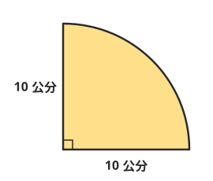

**題目**：上圖是半徑 10 公分的 1/4 圓。這個扇形的周長大約是幾公分？

**正解**：約 35.7 公分

**干擾項**

- 約 15.7 公分　←　只算了弧長，忘了加上兩條半徑
- 約 25.7 公分　←　只加了一條半徑
- 約 78.5 公分　←　算成扇形的面積

**提示**

1. 扇形的周長，是圍成扇形的所有邊的長度：一段弧，加上兩條半徑。
2. 先算弧長：整個圓周長 10×2×3.14 的 1/4。
3. 弧長 15.7 公分，再加上兩條半徑 10＋10。

**詳解**：扇形的周長＝弧長＋兩條半徑。弧長＝10×2×3.14×1/4＝15.7 公分，周長＝15.7＋10＋10＝35.7，大約是 35.7 公分。15.7 只算了弧長，忘了加上兩條半徑（這是最常忘記的地方）；25.7 只加了一條半徑；78.5 是算成扇形的面積。

驗算提示：沿著扇形的邊走一圈：從圓心走 10 公分到圓周，沿著弧走 15.7 公分，再走 10 公分回到圓心。

**驗證**：程式重算：10*2*3.14/4+10+10 ＝ 35.7（另外驗算了干擾項和詳解裡的 3 個算式）

---

### L11-Q4　求扇形的面積

**題目**：半徑 8 公分、圓心角 45° 的扇形，面積大約是幾平方公分？

**正解**：約 25.12 平方公分

**干擾項**

- 約 100.48 平方公分　←　把半徑乘以 2 當成半徑代入
- 約 6.28 平方公分　←　用了圓周長公式
- 約 50.24 平方公分　←　用 180° 去除，算成 1/4 圓

**提示**

1. 先判斷這個扇形是幾分之幾圓：45° 占 360° 的幾分之幾？
2. 45÷360＝1/8，扇形面積是整個圓面積的 1/8。
3. 圓面積＝8×8×3.14＝200.96，再乘以 1/8。

**詳解**：圓心角 45°，45÷360＝1/8，是 1/8 圓。整個圓面積＝8×8×3.14＝200.96 平方公分，扇形面積＝200.96×1/8＝25.12，大約是 25.12 平方公分。100.48 是把半徑乘以 2 當成半徑代入；6.28 是用了圓周長；50.24 是用 180° 去除，算成 1/4 圓。

驗算提示：8 個這樣的扇形拼成整個圓：25.12×8＝200.96。

**驗證**：程式重算：8*8*3.14*(45/360) ＝ 25.12（另外驗算了干擾項和詳解裡的 6 個算式）

---

### L11-Q5　半徑相同，圓心角的倍數和面積的倍數

**題目**：甲、乙兩個扇形的半徑一樣長。甲的圓心角是 40°，乙的圓心角是 120°。乙的面積是甲的幾倍？

**正解**：3 倍

**干擾項**

- 9 倍　←　和「半徑變幾倍」搞混，以為面積要變「幾倍再乘幾倍」
- 1/3 倍　←　順序反了，算成甲是乙的幾倍
- 一樣大，因為半徑一樣　←　以為半徑一樣，扇形面積就一樣

**提示**

1. 半徑一樣時，扇形的大小只和圓心角有關。
2. 乙的圓心角是甲的幾倍？120÷40＝？
3. 半徑相同，圓心角變幾倍，扇形面積也變幾倍。

**詳解**：半徑一樣，扇形面積＝圓面積×（圓心角÷360），圓面積相同，只差在圓心角。乙的圓心角是甲的 120÷40＝3 倍，所以乙的面積也是甲的 3 倍（弧長也是 3 倍）。9 倍是和「半徑變 3 倍」搞混了，半徑變大時面積才會變成 3×3 倍；1/3 倍是算成甲是乙的幾倍；半徑一樣不代表面積一樣，還要看圓心角。

驗算提示：用半徑 3 公分試試看：甲 3×3×3.14×40/360＝3.14，乙 3×3×3.14×120/360＝9.42，9.42÷3.14＝3。

**驗證**：程式重算：(120/360)/(40/360) ＝ 3（另外驗算了干擾項和詳解裡的 4 個算式）

---

### L11-Q6　素養：生活情境（摺扇的扇面）

**題目**：阿嬤有一把竹子做的摺扇。扇子完全打開時，扇面剛好是一個扇形：扇骨長 30 公分，打開的角度是 120°。這把扇子打開後，扇面的面積大約是多少？

**正解**：約 942 平方公分

**干擾項**

- 約 2826 平方公分　←　算的是整個圓的面積，忘了乘以 1/3
- 約 62.8 平方公分　←　算成扇面的弧長，不是面積
- 約 235.5 平方公分　←　讀錯半徑，把扇骨長當成直徑（用 15 公分當半徑）

**提示**

1. 先讀題：扇骨從扇子的轉軸連到扇面的邊，是扇形的哪一部分？打開的角度又是什麼？
2. 扇骨長就是半徑 30 公分，打開的角度就是圓心角 120°；120° 是 1/3 圓。
3. 扇面面積＝30×30×3.14×1/3。

**詳解**：扇骨從轉軸（圓心）連到扇面邊緣，是半徑 30 公分；打開 120° 是圓心角，120÷360＝1/3，扇面是 1/3 圓。面積＝30×30×3.14×1/3＝942，大約是 942 平方公分。2826 是整個圓的面積，忘了乘以 1/3；62.8 是扇面的弧長（30×2×3.14×1/3），不是面積；235.5 是把扇骨長當成直徑，用 15 公分當半徑。

驗算提示：3 把這樣的扇子打開拼在一起，剛好是一整個圓：942×3＝2826。

**驗證**：程式重算：30*30*3.14*(120/360) ＝ 942（另外驗算了干擾項和詳解裡的 5 個算式）

---

### L11-Q7　素養：附件題（同半徑、不同圓心角的扇形對照表）

**附件**
| 圓心角 | 幾分之幾圓 | 弧長（公分） | 面積（平方公分） |
|---|---|---|---|
| 30° | 1/12 | 3.14 | 9.42 |
| 60° | 1/6 | 6.28 | 18.84 |
| 90° | 1/4 | 9.42 | 28.26 |
| 180° | 1/2 | ？ | ？ |

**題目**：上表是半徑 6 公分、圓心角不同的扇形。表格最後一列（圓心角 180°）的弧長和面積應該是多少？

**正解**：弧長約 18.84 公分，面積約 56.52 平方公分

**干擾項**

- 弧長約 18.84 公分，面積約 113.04 平方公分　←　圓心角變 2 倍，以為面積要變 2×2 倍
- 弧長約 37.68 公分，面積約 113.04 平方公分　←　把 180° 的扇形當成整個圓
- 弧長約 9.42 公分，面積約 28.26 平方公分　←　表格看錯列，抄到 90° 那一列

**提示**

1. 先讀表格：半徑都一樣，圓心角從 30° 變到 60°、90°，弧長和面積怎麼變？
2. 半徑相同時，圓心角變幾倍，弧長和面積就變幾倍。180° 是 90° 的幾倍？
3. 180° 是 90° 的 2 倍：弧長 9.42×2，面積 28.26×2。

**詳解**：半徑相同時，圓心角變幾倍，弧長和面積也變幾倍。180° 是 90° 的 2 倍，弧長＝9.42×2＝18.84 公分，面積＝28.26×2＝56.52 平方公分。也可以直接算：180° 是 1/2 圓，弧長＝6×2×3.14×1/2＝18.84，面積＝6×6×3.14×1/2＝56.52。面積 113.04 是以為面積要變 2×2 倍，那是半徑變 2 倍的時候；37.68 和 113.04 是整個圓，180° 只是半圓；9.42 和 28.26 是抄到 90° 那一列。

驗算提示：表格裡每一列都是：弧長＝37.68×幾分之幾、面積＝113.04×幾分之幾。

**驗證**：概念判斷題，請人工確認：半徑 6 公分：弧長＝37.68×幾分之幾，面積＝113.04×幾分之幾；180° 為 1/2 圓（另外驗算了干擾項和詳解裡的 15 個算式）

---

## L12

### L12-Q1　動物在牆角能活動的範圍（3/4 圓）

**附件**

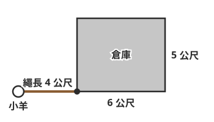

**題目**：上圖中，小羊用 4 公尺長的繩子綁在倉庫外面的牆角，倉庫裡面小羊進不去（倉庫的牆比繩子長）。小羊可以吃到草的範圍大約是幾平方公尺？

**正解**：約 37.68 平方公尺

**干擾項**

- 約 50.24 平方公尺　←　算成整個圓，沒有扣掉倉庫擋住的部分
- 約 12.56 平方公尺　←　以為綁在牆角就只能在 1/4 圓裡活動
- 約 18.84 平方公尺　←　算成弧長，不是面積

**提示**

1. 看圖：小羊被綁在牆角，繩子拉直時可以走到的地方是一個圓的一部分。
2. 倉庫擋住了一個直角（90°），小羊可以去的地方是 360°－90°＝270°，是幾分之幾圓？
3. 270° 是 3/4 圓，面積＝4×4×3.14×3/4。

**詳解**：繩子長 4 公尺，小羊能到的地方是以牆角為圓心、半徑 4 公尺的圓，但倉庫擋住了直角的 90°，剩下 360°－90°＝270°，是 3/4 圓。面積＝4×4×3.14×3/4＝37.68，大約是 37.68 平方公尺。50.24 是整個圓，沒有扣掉倉庫擋住的部分；12.56 是只算了 1/4 圓；18.84 是算成弧長，不是面積。

驗算提示：整個圓 50.24 平方公尺，扣掉倉庫擋住的 1/4（12.56），50.24－12.56＝37.68。

**驗證**：程式重算：4*4*3.14*(3/4) ＝ 37.68（另外驗算了干擾項和詳解裡的 5 個算式）

---

### L12-Q2　大扇形扣掉小扇形

**附件**

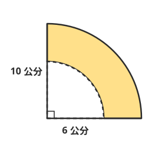

**題目**：上圖的塗色部分，是從半徑 10 公分的 1/4 圓，挖掉同一個圓心、半徑 6 公分的 1/4 圓。塗色部分的面積大約是幾平方公分？

**正解**：約 50.24 平方公分

**干擾項**

- 約 12.56 平方公分　←　先把半徑相減（10－6＝4）再算面積
- 約 78.5 平方公分　←　只算了大扇形，忘了扣掉小扇形
- 約 106.76 平方公分　←　把兩個扇形加起來了

**提示**

1. 塗色部分＝大扇形的面積－小扇形的面積。
2. 兩個都是 1/4 圓：大的半徑 10 公分，小的半徑 6 公分，分別算面積。
3. 大：10×10×3.14×1/4＝78.5；小：6×6×3.14×1/4＝28.26。

**詳解**：塗色部分是大扇形扣掉小扇形。大扇形＝10×10×3.14×1/4＝78.5 平方公分，小扇形＝6×6×3.14×1/4＝28.26 平方公分，塗色部分＝78.5－28.26＝50.24，大約是 50.24 平方公分。12.56 是先把半徑相減（10－6＝4）再算，但面積不能這樣減；78.5 只算了大扇形；106.76 是把兩個扇形加起來了。

驗算提示：也可以先減再乘：（10×10－6×6）×3.14×1/4＝64×3.14×1/4＝50.24。

**驗證**：程式重算：10*10*3.14/4-6*6*3.14/4 ＝ 50.24（另外驗算了干擾項和詳解裡的 5 個算式）

---

### L12-Q3　1/4 圓扣掉等腰直角三角形

**附件**

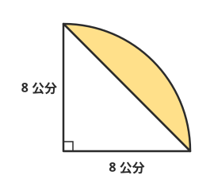

**題目**：上圖是半徑 8 公分的 1/4 圓，連接兩條半徑的端點，畫出一個等腰直角三角形。塗色部分（扇形扣掉三角形）的面積大約是幾平方公分？

**正解**：約 18.24 平方公分

**干擾項**

- 約 13.76 平方公分　←　三角形面積忘了除以 2（算成 64），減不下去只好反過來減
- 約 50.24 平方公分　←　只算了扇形，忘了扣掉三角形
- 約 82.24 平方公分　←　把扇形和三角形加起來了

**提示**

1. 塗色部分＝1/4 圓的面積－三角形的面積。
2. 1/4 圓面積＝8×8×3.14×1/4；三角形的底和高都是半徑 8 公分。
3. 三角形面積＝8×8÷2＝32，記得要除以 2。

**詳解**：1/4 圓面積＝8×8×3.14×1/4＝50.24 平方公分；等腰直角三角形的兩條直角邊都是 8 公分，面積＝8×8÷2＝32 平方公分。塗色部分＝50.24－32＝18.24，大約是 18.24 平方公分。13.76 是三角形面積忘了除以 2（算成 64），減不下去只好反過來減；50.24 只算了扇形；82.24 是把扇形和三角形加起來。

驗算提示：塗色部分是扇形邊上的一小片，18.24 比扇形的 50.24 小很多，合理。

**驗證**：程式重算：8*8*3.14/4-8*8/2 ＝ 18.24（另外驗算了干擾項和詳解裡的 4 個算式）

---

### L12-Q4　正方形扣掉 1/4 圓

**附件**

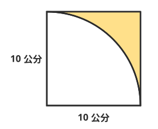

**題目**：上圖是邊長 10 公分的正方形，以左下角的頂點為圓心、邊長為半徑，畫了一個 1/4 圓。塗色部分（正方形扣掉 1/4 圓）的面積大約是幾平方公分？

**正解**：約 21.5 平方公分

**干擾項**

- 約 78.5 平方公分　←　算的是 1/4 圓本身，不是塗色部分
- 約 84.3 平方公分　←　減掉的是弧長（15.7 公分），長度不能和面積相減
- 約 214 平方公分　←　減成整個圓（314－100），圖裡只有 1/4 個圓

**提示**

1. 塗色部分＝正方形的面積－1/4 圓的面積。
2. 1/4 圓的半徑就是正方形的邊長 10 公分。
3. 正方形 10×10＝100；1/4 圓 10×10×3.14×1/4＝78.5。

**詳解**：正方形面積＝10×10＝100 平方公分。1/4 圓的半徑等於邊長 10 公分，面積＝10×10×3.14×1/4＝78.5 平方公分。塗色部分＝100－78.5＝21.5，大約是 21.5 平方公分。78.5 是 1/4 圓本身，不是塗色部分；84.3 是減掉弧長（15.7 公分），長度不能和面積相減；214 是減成整個圓（314－100），圖裡只有 1/4 個圓。

驗算提示：塗色部分在正方形的一個角落，比正方形的一半（50）小很多，21.5 合理。

**驗證**：程式重算：10*10-10*10*3.14/4 ＝ 21.5（另外驗算了干擾項和詳解裡的 4 個算式）

---

### L12-Q5　長方形扣掉兩個半圓

**附件**

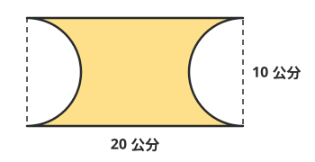

**題目**：上圖是長 20 公分、寬 10 公分的長方形，左右兩邊各挖掉一個半圓（半圓的直徑就是長方形的寬）。剩下的塗色部分，面積大約是幾平方公分？

**正解**：約 121.5 平方公分

**干擾項**

- 約 160.75 平方公分　←　兩個半圓只扣了一個
- 約 43 平方公分　←　把兩個半圓當成兩個整圓扣掉
- 約 168.6 平方公分　←　扣掉的是圓周長（10×3.14），長度不能和面積相減

**提示**

1. 塗色部分＝長方形的面積－兩個半圓的面積。
2. 兩個一樣大的半圓，合起來剛好是一個圓；半圓的直徑是 10 公分。
3. 長方形 20×10＝200；一個圓 5×5×3.14＝78.5。

**詳解**：長方形面積＝20×10＝200 平方公分。兩個半圓的直徑都是 10 公分，合起來是一個半徑 5 公分的圓：5×5×3.14＝78.5 平方公分。塗色部分＝200－78.5＝121.5，大約是 121.5 平方公分。160.75 只扣了一個半圓（39.25）；43 是把兩個半圓當成兩個整圓扣掉；168.6 是扣成圓周長（10×3.14），長度不能和面積相減。

驗算提示：一個半圓是 39.25 平方公分，200－39.25－39.25＝121.5，答案一樣。

**驗證**：程式重算：20*10-5*5*3.14 ＝ 121.5（另外驗算了干擾項和詳解裡的 6 個算式）

---

### L12-Q6　素養：繩子繞過牆角（不同半徑的扇形相加）

**附件**

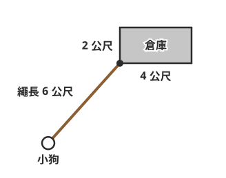

**題目**：農場的小狗用 6 公尺長的繩子，綁在一間長 4 公尺、寬 2 公尺的長方形倉庫外面的牆角（如上圖）。小狗進不了倉庫，但繩子可以沿著牆繞過轉角。小狗可以活動的範圍大約是幾平方公尺？

**正解**：約 100.48 平方公尺

**干擾項**

- 約 84.78 平方公尺　←　只算了 3/4 圓，忘了繩子會繞過轉角
- 約 141.3 平方公尺　←　繞過轉角後，半徑還用 6 公尺，沒有扣掉牆的長度
- 約 113.04 平方公尺　←　算成整個圓，沒注意倉庫擋住的地方小狗進不去

**提示**

1. 先畫畫看：繩子拉直時，有一大塊是以牆角為圓心、半徑 6 公尺的扇形，倉庫擋住了其中的 90°。
2. 繩子沿著 4 公尺的牆走到轉角，還剩 6－4＝2 公尺；沿著 2 公尺的牆走到轉角，還剩 6－2＝4 公尺。轉角處又各多出一個 1/4 圓。
3. 面積＝6×6×3.14×3/4＋2×2×3.14×1/4＋4×4×3.14×1/4。

**詳解**：小狗的活動範圍分成三塊：①以綁繩的牆角為圓心、半徑 6 公尺的 3/4 圓：6×6×3.14×3/4＝84.78；②繩子沿著 4 公尺的牆繞過轉角，剩下 2 公尺，是半徑 2 公尺的 1/4 圓：2×2×3.14×1/4＝3.14；③沿著 2 公尺的牆繞過轉角，剩下 4 公尺，是半徑 4 公尺的 1/4 圓：4×4×3.14×1/4＝12.56。合起來 84.78＋3.14＋12.56＝100.48，大約是 100.48 平方公尺。84.78 只算了第一塊，忘了繩子會繞過轉角；141.3 是繞過轉角後半徑還用 6 公尺，沒有扣掉牆的長度；113.04 是整個圓，倉庫擋住的地方小狗進不去。

驗算提示：轉角後的半徑＝繩長－牆長，一定比 6 公尺短：6－4＝2、6－2＝4。

**驗證**：程式重算：6*6*3.14*3/4+2*2*3.14/4+4*4*3.14/4 ＝ 100.48（另外驗算了干擾項和詳解裡的 6 個算式）

---

### L12-Q7　素養：附件題（移補法）

**附件**

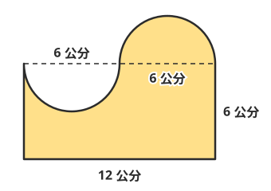

**題目**：上圖的塗色圖形，是在長 12 公分、寬 6 公分的長方形上，左邊挖掉一個半圓、右邊加上一個一樣大的半圓（兩個半圓的直徑都是 6 公分）。塗色圖形的面積是幾平方公分？

**正解**：72 平方公分

**干擾項**

- 約 86.13 平方公分　←　只加了右邊多出的半圓，忘了扣掉左邊挖掉的
- 約 57.87 平方公分　←　只扣了左邊挖掉的半圓，忘了加上右邊多出的
- 約 100.26 平方公分　←　把兩個半圓都加上去了

**提示**

1. 看圖：右邊多出來的半圓，和左邊挖掉的半圓一樣大。
2. 如果把右邊多出來的半圓切下來，移到左邊的缺口，會拼成什麼圖形？
3. 拼好後是長 12 公分、寬 6 公分的長方形。

**詳解**：右邊多出的半圓和左邊挖掉的半圓一樣大（直徑都是 6 公分），把多出的半圓移到缺口補起來，剛好拼成長 12 公分、寬 6 公分的長方形，面積＝12×6＝72 平方公分。這樣移補，連圓周率都不用算，所以答案剛好是 72，不是「大約」。86.13 是只加了多出的半圓（14.13）；57.87 是只扣掉挖掉的半圓；100.26 是把兩個半圓都加上去了。

驗算提示：一加一減：72＋14.13－14.13＝72，兩個半圓剛好抵消。

**驗證**：程式重算：12*6 ＝ 72（另外驗算了干擾項和詳解裡的 4 個算式）

---

## L13

### L13-Q1　比較快慢（同距離比時間）

**題目**：小安 8 秒跑完 50 公尺，小葳 9 秒跑完 50 公尺。誰跑得比較快？

**正解**：小安，同樣跑 50 公尺，花的時間比較少

**干擾項**

- 小葳，花的時間比較多，表示跑得比較快　←　以為花的時間愈長，跑得愈快
- 一樣快，因為兩人都跑 50 公尺　←　只看距離，沒有看時間
- 小葳，因為 9 比 8 大　←　只比數字大小，沒想清楚數字代表的是時間

**提示**

1. 兩個人跑的距離一樣，都是 50 公尺。
2. 距離一樣時，花的時間愈少，表示跑得愈快還是愈慢？
3. 比一比 8 秒和 9 秒，誰比較早跑完？

**詳解**：兩人都跑 50 公尺，距離一樣，就比花的時間：小安 8 秒、小葳 9 秒，小安比較早跑完，所以小安比較快。花的時間愈多，表示跑得愈慢，不是愈快；距離一樣不代表一樣快，還要看時間；9 比 8 大，是時間比較長，不能拿來說比較快。

驗算提示：算算平均 1 秒跑多遠：小安 50÷8＝6.25 公尺，小葳 50÷9 大約 5.56 公尺，小安每秒跑得比較遠。

**驗證**：概念判斷題，請人工確認：距離相同，時間較短者較快（另外驗算了干擾項和詳解裡的 2 個算式）

---

### L13-Q2　求分速

**題目**：一隻鴿子 5 分鐘飛了 4000 公尺。牠的分速是多少？

**正解**：分速 800 公尺

**干擾項**

- 分速 1/800 公尺　←　用時間÷距離，順序反了
- 分速 20000 公尺　←　把距離乘以時間
- 秒速 800 公尺　←　數字對了，但速率單位配錯；800 公尺是 1 分鐘飛的

**提示**

1. 分速是平均 1 分鐘移動的距離。
2. 速率＝距離÷時間：4000 公尺÷5 分鐘。
3. 4000÷5＝800，單位是「每分鐘幾公尺」，要寫成哪一種速率？

**詳解**：分速是平均 1 分鐘移動的距離，速率＝距離÷時間＝4000÷5＝800，鴿子的分速是 800 公尺（800 公尺／分）。1/800 是用時間÷距離，順序反了；20000 是把距離乘以時間；秒速 800 公尺是單位配錯了，800 公尺是 1 分鐘飛的，不是 1 秒。

驗算提示：速率×時間＝距離：800×5＝4000 公尺。

**驗證**：程式重算：4000/5 ＝ 800（另外驗算了干擾項和詳解裡的 3 個算式）

---

### L13-Q3　求時速，用正確的速率單位表示

**題目**：高鐵列車 2 小時行駛了 560 公里。列車的平均速率要怎麼表示？

**正解**：時速 280 公里

**干擾項**

- 分速 280 公里　←　速率單位配錯；時間是用小時算的，應該是時速
- 時速 1120 公里　←　把距離乘以時間
- 280 公里　←　少寫了速率的單位，看起來像一段距離

**提示**

1. 時間的單位是小時，算出來的是平均 1 小時行駛的距離。
2. 速率＝距離÷時間：560÷2。
3. 560÷2＝280，平均 1 小時 280 公里，要寫成哪一種速率？

**詳解**：速率＝距離÷時間＝560÷2＝280，表示平均 1 小時行駛 280 公里，寫成時速 280 公里（或 280 公里／時）。分速 280 公里是單位配錯了，時間是用小時算的；1120 是把距離乘以時間；只寫 280 公里少了速率的單位，看起來像一段距離，回答速率時要寫完整。

驗算提示：時速 280 公里×2 小時＝560 公里。

**驗證**：程式重算：560/2 ＝ 280（另外驗算了干擾項和詳解裡的 2 個算式）

---

### L13-Q4　速率固定時，求距離

**題目**：一台自動割草機的分速是 15 公尺，速率固定不變。它工作 12 分鐘，可以前進幾公尺？

**正解**：180 公尺

**干擾項**

- 1.25 公尺　←　公式用反，算成速率÷時間
- 0.8 公尺　←　公式用反，算成時間÷速率
- 27 公尺　←　把速率和時間加起來

**提示**

1. 分速 15 公尺，表示每 1 分鐘前進 15 公尺。
2. 速率固定時，距離＝速率×時間。
3. 15×12＝？

**詳解**：分速 15 公尺是每分鐘前進 15 公尺，12 分鐘前進 15×12＝180 公尺（距離＝速率×時間）。1.25 是用速率÷時間；0.8 是用時間÷速率，公式用反了；27 是把速率和時間加起來。

驗算提示：距離÷時間＝速率：180÷12＝15，和分速一樣。

**驗證**：程式重算：15*12 ＝ 180（另外驗算了干擾項和詳解裡的 4 個算式）

---

### L13-Q5　速率單位換算（時速換分速）

**題目**：時速 72 公里，換成分速是多少公尺？

**正解**：分速 1200 公尺

**干擾項**

- 分速 1.2 公尺　←　72÷60 之後，忘了把公里換成公尺
- 分速 4320000 公尺　←　換算方向反了，把÷60 做成×60
- 分速 1200 公里　←　距離單位寫錯，1 分鐘不可能走 1200 公里

**提示**

1. 時速是 1 小時走的距離，分速是 1 分鐘走的距離；1 小時＝60 分鐘。
2. 時速÷60＝分速；題目要公尺，72 公里＝72000 公尺。
3. 72000÷60＝？

**詳解**：時速 72 公里是 1 小時走 72 公里＝72000 公尺。1 小時＝60 分鐘，1 分鐘走 72000÷60＝1200 公尺，分速是 1200 公尺。1.2 是 72÷60 之後沒有把公里換成公尺；4320000 是把÷60 做成×60，換算方向反了；1200 公里是單位寫錯，1 分鐘不可能走 1200 公里。

驗算提示：分速 1200 公尺×60 分鐘＝72000 公尺＝72 公里，就是時速 72 公里。

**驗證**：程式重算：72*1000/60 ＝ 1200（另外驗算了干擾項和詳解裡的 3 個算式）

---

### L13-Q6　素養：比較不同單位的速率

**題目**：運動會的大隊接力，老師記錄了三位選手的速率：阿哲秒速 5 公尺、小安分速 280 公尺、小葳時速 17.4 公里。三個人都用自己的速率跑，誰最快？

**正解**：阿哲，換成分速是 300 公尺，最快

**干擾項**

- 小安，因為 280 這個數字最大　←　沒有換成同一種單位，就直接比數字
- 小葳，時速 17.4 公里換成分速是 1044 公尺　←　時速換分速時乘以 60，換算方向反了
- 小安，分速 280 公尺換成秒速是 16800 公尺　←　分速換秒速時乘以 60，換算方向反了

**提示**

1. 三個速率的單位不一樣，不能直接比數字，要先換成同一種單位。
2. 都換成分速：秒速×60＝分速；時速要先把公里換成公尺，再÷60。
3. 阿哲 5×60；小葳 17400÷60；再和小安的 280 比。

**詳解**：先都換成分速：阿哲秒速 5 公尺，1 分鐘跑 5×60＝300 公尺；小安分速 280 公尺；小葳時速 17.4 公里＝17400 公尺，1 分鐘跑 17400÷60＝290 公尺。300 最大，阿哲最快。只看 280 最大是沒有換單位；17.4×60＝1044 是時速換分速時乘錯方向（應該除以 60）；280×60 是分速換秒速時乘錯方向（也應該除以 60）。

驗算提示：都換成秒速再比一次：阿哲 5、小安 280÷60 大約 4.67、小葳 290÷60 大約 4.83，還是阿哲最快。

**驗證**：程式重算：阿哲＝5*60、小安＝280、小葳＝17.4*1000/60，最大的是 阿哲（另外驗算了干擾項和詳解裡的 6 個算式）

---

### L13-Q7　素養：附件題（距離和時間的對照表）

**附件**
| 騎的時間（分） | 5 | 10 | 15 | 20 |
|---|---|---|---|---|
| 前進的距離（公尺） | 1250 | 2500 | 3750 | ？ |

**題目**：上表是小哲用固定的速率騎自行車時，騎的時間和前進的距離。下面哪一個說法正確？

**正解**：他的分速是 250 公尺，騎 20 分鐘會前進 5000 公尺

**干擾項**

- 騎的時間愈長，他的速率就愈快　←　把「距離愈來愈遠」誤會成「速率愈來愈快」
- 他的分速是 1250 公尺　←　表格看錯，把 5 分鐘的距離當成 1 分鐘的距離
- 他的分速是 1/250 公尺　←　用時間÷距離算速率，順序反了

**提示**

1. 先讀表格：上面一列是時間，下面一列是距離，速率是固定的。
2. 速率＝距離÷時間，任選一欄算算看：1250÷5。
3. 分速 250 公尺，20 分鐘的距離＝250×20。

**詳解**：速率＝距離÷時間：1250÷5＝250，每一欄都一樣（2500÷10、3750÷15 也是 250），分速是 250 公尺，速率沒有變。20 分鐘的距離＝250×20＝5000 公尺，時間變成 4 倍，距離也變成 4 倍。時間愈長距離愈遠，是因為騎得久，不是速率變快；分速 1250 公尺是把 5 分鐘的距離當成 1 分鐘；1/250 是用時間÷距離。

驗算提示：5000÷20＝250，和其他欄的分速一樣。

**驗證**：程式重算：1250/5*20 ＝ 5000（另外驗算了干擾項和詳解裡的 5 個算式）

---

## L14

### L14-Q1　求時間（含小時和分鐘的換算）

**題目**：一輛遊覽車以時速 60 公里行駛，要開 45 公里才會到達目的地。要開幾分鐘？

**正解**：45 分鐘

**干擾項**

- 0.75 分鐘　←　算出來的 0.75 是小時，沒有換成分鐘
- 80 分鐘　←　公式用反，算成速率÷距離（60÷45 小時）
- 2700 分鐘　←　把距離乘以 60

**提示**

1. 時間＝距離÷速率。時速 60 公里表示 1 小時開 60 公里。
2. 45÷60 算出來的單位是小時；題目要的是分鐘。
3. 45÷60＝0.75 小時，1 小時＝60 分鐘，0.75 小時是幾分鐘？

**詳解**：時間＝距離÷速率＝45÷60＝0.75 小時。1 小時＝60 分鐘，0.75 小時＝0.75×60＝45 分鐘。也可以這樣想：1 小時開 60 公里，就是 1 分鐘開 1 公里，45 公里要 45 分鐘。0.75 分鐘是算出小時之後沒有換成分鐘；80 分鐘是用速率÷距離（60÷45），公式用反了；2700 是把距離乘以 60。

驗算提示：速率×時間＝距離：時速 60 公里×0.75 小時＝45 公里。

**驗證**：程式重算：45/60*60 ＝ 45（另外驗算了干擾項和詳解裡的 4 個算式）

---

### L14-Q2　求距離（速率和時間的單位要一致）

**題目**：一架空拍機的秒速是 12 公尺，它飛了 3 分鐘。一共飛了幾公尺？

**正解**：2160 公尺

**干擾項**

- 36 公尺　←　速率是秒速，時間卻沒有換成秒（直接 12×3）
- 4 公尺　←　用成除法
- 720 公尺　←　只算了 1 分鐘（12×60），忘了再乘以 3

**提示**

1. 速率是「秒速」，時間卻是「分鐘」，單位要先換成一樣。
2. 3 分鐘＝3×60＝180 秒。距離＝速率×時間。
3. 12×180＝？

**詳解**：秒速 12 公尺是每秒飛 12 公尺，時間要用秒：3 分鐘＝180 秒，距離＝12×180＝2160 公尺。36 公尺是時間沒換成秒，直接 12×3；4 是用成除法；720 公尺只算了 1 分鐘（12×60），還要再乘以 3。

驗算提示：也可以先換成分速：秒速 12 公尺＝分速 720 公尺，720×3＝2160 公尺，答案一樣。

**驗證**：程式重算：12*3*60 ＝ 2160（另外驗算了干擾項和詳解裡的 5 個算式）

---

### L14-Q3　平均速率

**題目**：阿嬤走路去市場買菜：去程 1200 公尺走了 20 分鐘；回程提著菜，同樣 1200 公尺走了 30 分鐘。阿嬤來回的平均分速是多少公尺？

**正解**：分速 48 公尺

**干擾項**

- 分速 50 公尺　←　把兩段的速率（60 和 40）相加再除以 2
- 分速 100 公尺　←　把兩段的速率直接相加
- 分速 24 公尺　←　只用了單程的距離（1200÷50）

**提示**

1. 平均速率要用「全部的距離」除以「全部的時間」。
2. 全部的距離＝1200＋1200 公尺；全部的時間＝20＋30 分鐘。
3. 2400÷50＝？

**詳解**：平均速率＝總距離÷總時間＝（1200＋1200）÷（20＋30）＝2400÷50＝48，平均分速是 48 公尺。去程分速 60、回程分速 40，把兩個速率相加再除以 2 得到 50，是常見的錯誤：回程走得比較久，慢的那一段占的時間比較多，不能直接平均；100 是兩段速率相加；24 是只用了單程的距離。

驗算提示：分速 48 公尺×50 分鐘＝2400 公尺，剛好是來回的距離。

**驗證**：程式重算：(1200+1200)/(20+30) ＝ 48（另外驗算了干擾項和詳解裡的 6 個算式）

---

### L14-Q4　同時同地同方向，求相距多遠

**題目**：哥哥和弟弟同時從家門口出發，往同一個方向騎腳踏車。哥哥的分速是 250 公尺，弟弟的分速是 180 公尺。騎了 8 分鐘後，兩人相距多少公尺？

**正解**：560 公尺

**干擾項**

- 3440 公尺　←　用了速率和，那是兩人往相反方向的情形
- 70 公尺　←　只算出 1 分鐘拉開的距離，忘了乘以時間
- 2000 公尺　←　只算了哥哥騎的距離

**提示**

1. 兩人同時、同地、往同一個方向出發，每過 1 分鐘，哥哥就比弟弟多騎一段。
2. 每分鐘多騎的距離＝兩人的速率差：250－180。
3. 速率差 70 公尺×8 分鐘＝？

**詳解**：同時同地同方向出發，每分鐘哥哥比弟弟多騎 250－180＝70 公尺，8 分鐘後相距 70×8＝560 公尺。也可以分別算：哥哥 250×8＝2000 公尺，弟弟 180×8＝1440 公尺，2000－1440＝560 公尺。3440 是用了速率和，那是兩人往相反方向的情形；70 只是 1 分鐘拉開的距離；2000 是哥哥騎的距離，不是兩人的距離。

驗算提示：2000－1440＝560，兩種算法答案一樣。

**驗證**：程式重算：(250-180)*8 ＝ 560（另外驗算了干擾項和詳解裡的 5 個算式）

---

### L14-Q5　同時由兩地相向而行，求多久相遇

**題目**：小安和小葳兩家相距 2.1 公里。兩人同時從自己家出發，沿著同一條路走向對方。小安的分速是 80 公尺，小葳的分速是 60 公尺。幾分鐘後兩人會相遇？

**正解**：15 分鐘

**干擾項**

- 105 分鐘　←　用了速率差，那是同方向追趕的情形
- 26.25 分鐘　←　只算了小安一個人走完全程的時間
- 0.015 分鐘　←　2.1 公里沒有換成公尺

**提示**

1. 兩人面對面走，每過 1 分鐘，兩人之間的距離會縮短多少？
2. 每分鐘縮短的距離＝兩人的速率和：80＋60。記得 2.1 公里要換成公尺。
3. 2100÷140＝？

**詳解**：兩人相向而行，每分鐘一起走了 80＋60＝140 公尺，兩人的距離每分鐘縮短 140 公尺。2.1 公里＝2100 公尺，相遇時間＝2100÷140＝15 分鐘。105 分鐘是用了速率差（2100÷20），那是同方向追趕的情形；26.25 分鐘是只算了小安一個人走完全程的時間；0.015 是公里沒有換成公尺。

驗算提示：15 分鐘後，小安走了 80×15＝1200 公尺、小葳走了 60×15＝900 公尺，1200＋900＝2100 公尺，剛好是兩家的距離。

**驗證**：程式重算：2100/(80+60) ＝ 15（另外驗算了干擾項和詳解裡的 4 個算式）

---

### L14-Q6　素養：行程規劃（算出到達時刻）

**題目**：校外教學的遊覽車早上 8 時 40 分從學校出發，以時速 50 公里開往 75 公里外的科學館，中途在休息站停了 20 分鐘。遊覽車幾時幾分到達科學館？

**正解**：10 時 30 分

**干擾項**

- 10 時 10 分　←　漏算了在休息站停留的 20 分鐘
- 10 時 50 分　←　把 1.5 小時當成 1 小時 50 分（0.5 小時其實是 30 分鐘）
- 1 時 50 分　←　只算了路上花的時間，沒有加上出發的時刻

**提示**

1. 先讀題：到達的時刻＝出發的時刻＋路上花的全部時間（開車加上停留）。
2. 開車時間＝距離÷速率＝75÷50 小時。0.5 小時是幾分鐘？
3. 75÷50＝1.5 小時＝1 小時 30 分，再加停留 20 分鐘，從 8 時 40 分往後算。

**詳解**：開車時間＝75÷50＝1.5 小時＝1 小時 30 分（0.5 小時＝30 分鐘）。加上休息站停留 20 分鐘，一共 1 小時 50 分。8 時 40 分再過 1 小時 50 分是 10 時 30 分。10 時 10 分是漏算了停留的 20 分鐘；10 時 50 分是把 1.5 小時當成 1 小時 50 分；1 時 50 分只是路上花的時間，不是到達的時刻。

驗算提示：從 8 時 40 分開始：開 1 小時 30 分到 10 時 10 分，再停 20 分鐘，就是 10 時 30 分。

**驗證**：概念判斷題，請人工確認：75÷50＝1.5 小時＝90 分，加停留 20 分，共 110 分；8:40＋1:50＝10:30（另外驗算了干擾項和詳解裡的 6 個算式）

---

### L14-Q7　素養：附件題（行程紀錄表，求平均速率）

**附件**
| 路段 | 距離 | 花的時間 |
|---|---|---|
| A 騎到 B | 30 公里 | 2 小時 |
| 在 B 休息 | 0 公里 | 1 小時 |
| B 騎到 C | 36 公里 | 3 小時 |

**題目**：上表是自行車隊第一天的行程紀錄。從 A 出發到 C 為止，包含在 B 休息的時間，車隊這一天的平均時速是多少公里？

**正解**：時速 11 公里

**干擾項**

- 時速 13.2 公里　←　漏算了休息的 1 小時（66÷5）
- 時速 13.5 公里　←　把兩段的時速 15 和 12 相加再除以 2
- 時速 27 公里　←　把兩段的時速直接相加

**提示**

1. 先讀表格：一共有三列，其中一列是休息，距離是 0，但也花了時間。
2. 平均速率＝總距離÷總時間；題目說要包含休息時間。
3. 總距離 30＋36＝66 公里，總時間 2＋1＋3＝6 小時。

**詳解**：平均速率＝總距離÷總時間。總距離＝30＋36＝66 公里，總時間＝2＋1＋3＝6 小時（題目說要包含休息時間），平均時速＝66÷6＝11 公里。13.2 是漏算了休息的 1 小時（66÷5）；13.5 是把兩段的時速 15 和 12 相加再除以 2；27 是把兩段的時速直接相加。

驗算提示：時速 11 公里×6 小時＝66 公里，等於這一天騎的距離。

**驗證**：程式重算：(30+36)/(2+1+3) ＝ 11（另外驗算了干擾項和詳解裡的 6 個算式）

---

## L15

### L15-Q1　和不變：寫出關係式

**題目**：一條 30 公分長的緞帶剪成兩段，一段長 □ 公分，另一段長 △ 公分。不管怎麼剪，□ 和 △ 的關係式是哪一個？

**正解**：□＋△＝30

**干擾項**

- □×△＝30　←　把「合起來」寫成乘法關係
- □－△＝30　←　以為兩段的差是固定的
- □÷△＝30　←　以為兩段的商是固定的

**提示**

1. 不管怎麼剪，兩段合起來都是原來的整條緞帶。
2. 兩段的長度「合起來」，要用哪一種運算？
3. 一段＋另一段＝整條的長度。

**詳解**：緞帶剪成兩段，不管怎麼剪，兩段的長度合起來都是 30 公分，所以 □＋△＝30（和不變）。例如剪成 10 和 20、12 和 18，加起來都是 30。□×△＝30 是寫成乘法，10×20＝200 不是 30；□－△ 和 □÷△ 會隨著剪法改變，不是固定的 30。

驗算提示：任選一種剪法代進去檢查：□＝7、△＝23，7＋23＝30，對了。

**驗證**：概念判斷題，請人工確認：兩段長度和固定為 30（另外驗算了干擾項和詳解裡的 4 個算式）

---

### L15-Q2　差不變：兩人的年齡差

**題目**：今年哥哥 13 歲，妹妹 8 歲。下面哪一個說法正確？

**正解**：再過 10 年，哥哥還是比妹妹大 5 歲

**干擾項**

- 再過 10 年，哥哥會比妹妹大 15 歲　←　以為年齡差也會隨著時間增加
- 哥哥的年齡永遠是妹妹的 13/8 倍　←　以為年齡的倍數也不變
- 再過 10 年，兩人的年齡和還是 21 歲　←　以為年齡和不變

**提示**

1. 每過 1 年，哥哥和妹妹都會增加幾歲？
2. 兩個人每年都多 1 歲，兩人相差的歲數會不會改變？
3. 再過 10 年：哥哥 23 歲、妹妹 18 歲，算算相差、相加和倍數。

**詳解**：每過 1 年，兩人都增加 1 歲，所以年齡差永遠不變（差不變）：13－8＝5，再過 10 年是 23－18＝5，哥哥還是大 5 歲。大 15 歲是以為差也會增加；倍數會變：今年 13÷8＝13/8，10 年後 23÷18＝23/18，不一樣；年齡和也會變：今年 21 歲，10 年後是 23＋18＝41 歲。

驗算提示：關係式寫成「哥哥的年齡－妹妹的年齡＝5」，任何一年代進去都成立。

**驗證**：概念判斷題，請人工確認：年齡差不變；倍數與和會改變（另外驗算了干擾項和詳解裡的 6 個算式）

---

### L15-Q3　積不變：每份的量×份數＝總數

**題目**：班上要把 48 張照片平均貼在相簿裡，「每頁貼的張數×頁數＝48」。如果每頁從貼 6 張改成貼 4 張，需要的頁數會怎麼變？

**正解**：從 8 頁變成 12 頁，每頁貼得少，頁數變多

**干擾項**

- 從 8 頁變成 6 頁，每頁貼得少，頁數也變少　←　以為兩個數會一起變大、一起變小
- 還是 8 頁，因為照片一樣多　←　以為總數不變，份數就不變
- 從 8 頁變成 10 頁，因為每頁少 2 張就多 2 頁　←　用加減來想，積不變要用乘除

**提示**

1. 總張數 48 張不變：每頁的張數×頁數＝48。
2. 每頁 6 張時，頁數是 48÷6；每頁 4 張時，頁數是 48÷4。
3. 算出兩個頁數比一比。

**詳解**：每頁張數×頁數＝48（積不變）。每頁 6 張要 48÷6＝8 頁；每頁 4 張要 48÷4＝12 頁。每頁貼得少，需要的頁數反而變多。以為頁數也變少，是把兩個數想成一起變大、一起變小；照片一樣多，頁數還是會隨每頁張數改變；少 2 張就多 2 頁是用了加減，積不變的關係要用乘除來想。

驗算提示：4×12＝48、6×8＝48，兩種都是 48 張。

**驗證**：概念判斷題，請人工確認：每頁張數×頁數＝48；6 張→8 頁，4 張→12 頁（另外驗算了干擾項和詳解裡的 4 個算式）

---

### L15-Q4　商不變：單價固定

**題目**：福利社的鉛筆 1 枝 12 元，價錢固定。買的枝數和總價之間，哪一個關係式一直成立？

**正解**：總價÷枝數＝12

**干擾項**

- 總價×枝數＝12　←　積不變和商不變混淆
- 總價－枝數＝12　←　以為差不變
- 總價＋枝數＝12　←　以為和不變

**提示**

1. 1 枝 12 元，買幾枝，總價就是幾個 12 元。
2. 總價和枝數一起變，但哪一個數一直不變？
3. 試試看：買 2 枝 24 元、買 5 枝 60 元，24 和 2、60 和 5 用哪一種運算會一直得到 12？

**詳解**：單價固定是 12 元，總價＝12×枝數，所以總價÷枝數＝12（商不變）。例如 24÷2＝12、60÷5＝12。總價×枝數會愈來愈大，不是固定的 12；總價－枝數、總價＋枝數也都會改變。

驗算提示：買 10 枝，總價 120 元，120÷10＝12，關係式成立。

**驗證**：概念判斷題，請人工確認：總價＝12×枝數，總價÷枝數＝12（另外驗算了干擾項和詳解裡的 4 個算式）

---

### L15-Q5　看表格判斷是哪一種「不變」

**附件**
|  | 第 1 組 | 第 2 組 | 第 3 組 | 第 4 組 |
|---|---|---|---|---|
| 甲 | 2 | 3 | 4 | 6 |
| 乙 | 18 | 12 | 9 | 6 |

**題目**：上表中，甲和乙的數量一起改變。它們之間是哪一種「不變」的關係？

**正解**：積不變：甲×乙＝36

**干擾項**

- 和不變：甲＋乙＝20　←　只看第 1 組（2＋18）就下結論
- 差不變：乙－甲＝16　←　只看第 1 組（18－2）就下結論
- 商不變：乙÷甲＝9　←　只看第 1 組（18÷2）就下結論

**提示**

1. 每一種關係都要用「每一組」數據檢查，不能只看第一組。
2. 把每一組的甲和乙分別相加、相減、相乘、相除，看哪一個結果一直都一樣。
3. 2×18、3×12、4×9、6×6 各是多少？

**詳解**：每一組的甲×乙：2×18＝36、3×12＝36、4×9＝36、6×6＝36，都是 36，所以是積不變：甲×乙＝36。只看第 1 組，2＋18＝20、18－2＝16、18÷2＝9 好像都成立，但第 2 組 3＋12＝15、12－3＝9、12÷3＝4 就不一樣了，所以和、差、商都不是不變的。

驗算提示：用最後一組再檢查一次：6×6＝36，成立。

**驗證**：概念判斷題，請人工確認：四組的甲×乙都等於 36（另外驗算了干擾項和詳解裡的 10 個算式）

---

### L15-Q6　素養：用關係式求未知量（積不變）

**題目**：六年級班遊包了一台遊覽車，車資一共 9000 元，由參加的人平均分攤，所以「每人付的錢×人數＝9000」。原本以為只有 30 人參加，後來共有 36 人參加。和原本以為的相比，每人可以少付幾元？

**正解**：少付 50 元

**干擾項**

- 少付 6 元　←　把多出來的人數當成少付的錢
- 多付 50 元　←　以為人數變多，每人付的錢也變多
- 少付 1500 元　←　關係式代錯數，算成 9000÷6

**提示**

1. 先讀題：車資 9000 元不變，人數變了，每人付的錢也會變。
2. 用關係式：每人付的錢＝9000÷人數。分別算 30 人和 36 人的時候。
3. 9000÷30＝300，9000÷36＝？再相減。

**詳解**：每人付的錢×人數＝9000（積不變），所以每人付的錢＝9000÷人數。30 人時每人付 9000÷30＝300 元，36 人時每人付 9000÷36＝250 元，每人少付 300－250＝50 元。6 是人數多了 6 人，不是錢；人數變多，每人付的錢會變少，不是變多；1500 是用 9000÷6，把多出來的 6 人代錯地方。

驗算提示：250×36＝9000，300×30＝9000，兩種都剛好是車資。

**驗證**：程式重算：9000/30-9000/36 ＝ 50（另外驗算了干擾項和詳解裡的 5 個算式）

---

### L15-Q7　素養：附件題（表格，選出正確的關係式）

**附件**
|  | 第 1 天 | 第 2 天 | 第 3 天 | 第 4 天 |
|---|---|---|---|---|
| 姊姊（元） | 150 | 160 | 170 | 180 |
| 弟弟（元） | 90 | 100 | 110 | 120 |

**題目**：上表是姊姊和弟弟存錢筒裡的錢。兩人每天都存一樣多的錢。下面哪一個關係式一直成立？

**正解**：姊姊的錢－弟弟的錢＝60

**干擾項**

- 姊姊的錢÷弟弟的錢＝5/3　←　只看第 1 天（150÷90），以為倍數不變
- 姊姊的錢＋弟弟的錢＝240　←　只看第 1 天，以為兩人的錢加起來不變
- 姊姊的錢－弟弟的錢＝10　←　把每天各存的 10 元當成兩人相差的錢

**提示**

1. 先讀表格：每過一天，姊姊和弟弟的錢各增加多少？
2. 兩人每天都多 10 元，兩人相差的錢會不會變？用每一天檢查。
3. 150－90、160－100、170－110、180－120 各是多少？

**詳解**：兩人每天都多存 10 元，相差的錢不會改變：150－90＝60、160－100＝60、170－110＝60、180－120＝60，所以「姊姊的錢－弟弟的錢＝60」一直成立（差不變）。150÷90＝5/3，但第 2 天 160÷100＝8/5，倍數變了；兩人的錢加起來每天都在變（240、260……）；10 元是每天各存的錢，不是兩人相差的錢。

驗算提示：再過一天是 190 元和 130 元，190－130＝60，還是成立。

**驗證**：概念判斷題，請人工確認：四天的姊姊－弟弟都等於 60（另外驗算了干擾項和詳解裡的 9 個算式）

---

## L16

### L16-Q1　加法原理：只選其中一樣

**題目**：午餐點心要從三個籃子裡選：水果籃有 4 種、餅乾籃有 3 種、麵包籃有 2 種。如果只能選一樣點心，一共有幾種選法？

**正解**：9 種

**干擾項**

- 24 種　←　用成乘法（4×3×2），那是每一籃都要各選一樣的情形
- 3 種　←　只算了籃子的數量
- 12 種　←　只把兩籃相乘

**提示**

1. 先讀題：題目說「只能選一樣」，是從三個籃子裡挑一個點心。
2. 只選一樣時，選水果、選餅乾、選麵包是不同的情況，要把每一種情況的選法合起來。
3. 4＋3＋2＝？

**詳解**：只能選一樣點心，可能選水果（4 種）、選餅乾（3 種）或選麵包（2 種），這三種情況不會同時發生，要用加法：4＋3＋2＝9 種。24 是用乘法（4×3×2），那是每一籃都要各選一樣的情形；3 種只算了籃子的數量；12 是只把兩籃相乘。

驗算提示：把選法一個一個數：水果 4 種、餅乾 3 種、麵包 2 種，數起來是 9 種。

**驗證**：程式重算：4+3+2 ＝ 9（另外驗算了干擾項和詳解裡的 2 個算式）

---

### L16-Q2　乘法原理：兩樣都要選

**題目**：小葳有 3 件上衣和 4 件裙子，要選 1 件上衣和 1 件裙子搭配成一套。一共有幾種不同的搭配？

**正解**：12 種

**干擾項**

- 7 種　←　用成加法；加法是「只選上衣或只選裙子其中一樣」的情形
- 3 種　←　以為每件上衣只能配一件裙子
- 24 種　←　把同一套算了兩次（上衣配裙子、裙子配上衣）

**提示**

1. 先讀題：上衣和裙子「都要選」，各選 1 件。
2. 先選上衣，每 1 件上衣都可以配 4 件裙子中的任何一件。
3. 3 件上衣，每件都有 4 種配法：3×4＝？

**詳解**：上衣和裙子都要選，每 1 件上衣都可以配 4 件裙子，所以有 3×4＝12 種搭配。7 是用加法，那是「只選上衣或只選裙子其中一樣」的情形；3 種是以為每件上衣只能配一件裙子；24 是把同一套算了兩次，「上衣甲配裙子乙」和「裙子乙配上衣甲」是同一套。

驗算提示：列出來檢查：上衣 A 配 4 件、上衣 B 配 4 件、上衣 C 配 4 件，4＋4＋4＝12。

**驗證**：程式重算：3*4 ＝ 12（另外驗算了干擾項和詳解裡的 3 個算式）

---

### L16-Q3　乘法原理：三樣都要選

**題目**：早餐店的套餐要選 1 種主餐、1 種飲料和 1 種配菜：主餐有 4 種、飲料有 3 種、配菜有 2 種。一共可以配出幾種不同的套餐？

**正解**：24 種

**干擾項**

- 9 種　←　用成加法
- 12 種　←　漏乘了配菜
- 6 種　←　漏乘了主餐

**提示**

1. 三樣都要選：主餐、飲料、配菜各選一種。
2. 先算主餐和飲料有幾種搭配，每一種搭配再配上配菜。
3. 4×3＝12，每一種再配 2 種配菜：12×2。

**詳解**：主餐、飲料、配菜三樣都要選，用乘法：4×3×2＝24 種。主餐和飲料先配出 4×3＝12 種，每一種再配上 2 種配菜，就是 24 種。9 是用加法；12 是漏乘了配菜；6 是漏乘了主餐。

驗算提示：固定一種主餐，飲料和配菜有 3×2＝6 種，4 種主餐就是 6×4＝24 種。

**驗證**：程式重算：4*3*2 ＝ 24（另外驗算了干擾項和詳解裡的 4 個算式）

---

### L16-Q4　數字卡排成兩位數（十位不能是 0）

**題目**：用 0、2、5、7 四張數字卡，選兩張排成一個兩位數（同一張卡不能重複用）。可以排出幾個不同的兩位數？

**正解**：9 個

**干擾項**

- 12 個　←　把 0 也放到十位（像 02、05 不是兩位數）
- 16 個　←　同一張卡重複用了
- 6 個　←　以為個位也不能放 0

**提示**

1. 兩位數的十位數字不能是 0，先想十位可以放哪幾張卡。
2. 十位有 2、5、7 三種選法；十位用掉一張後，個位還剩幾張可以用（0 可以放在個位）？
3. 十位 3 種，每一種的個位都有 3 種：3×3。

**詳解**：十位不能是 0，所以十位只能放 2、5 或 7，有 3 種；十位用掉一張後，剩下 3 張（包含 0）都可以放在個位，有 3 種。一共 3×3＝9 個：20、25、27、50、52、57、70、72、75。12 是把 0 也放到十位（像 02 不是兩位數）；16 是同一張卡重複用了；6 是以為個位也不能放 0。

驗算提示：把 9 個數全部列出來數一數：20、25、27、50、52、57、70、72、75。

**驗證**：程式重算：3*3 ＝ 9（另外驗算了干擾項和詳解裡的 3 個算式）

---

### L16-Q5　加法原理和乘法原理混合

**題目**：從學校到動物園，可以搭公車或搭捷運。搭公車有 2 條路線可以選；搭捷運要先選 3 條路線中的 1 條到轉乘站，再選 2 條路線中的 1 條到動物園。從學校到動物園一共有幾種走法？

**正解**：8 種

**干擾項**

- 12 種　←　分類之後又全部相乘（2×3×2）
- 7 種　←　全部相加，忘了捷運的兩段都要選
- 6 種　←　只算了搭捷運的走法

**提示**

1. 先分類：搭公車和搭捷運是兩種不同的情況，只會選其中一種。
2. 搭捷運要分兩段，每一段都要選：3 條×2 條。
3. 公車 2 種＋捷運 3×2 種＝？

**詳解**：搭公車或搭捷運只會選一種，所以兩類要相加；搭捷運要分兩段都選，所以捷運要用乘法：3×2＝6 種。一共 2＋6＝8 種走法。12 是分類之後又全部相乘（2×3×2）；7 是全部相加，忘了捷運兩段都要選；6 只算了捷運。

驗算提示：公車有 2 種；捷運第一段 3 條各配第二段 2 條，共 6 種；2＋6＝8。

**驗證**：程式重算：2+3*2 ＝ 8（另外驗算了干擾項和詳解裡的 3 個算式）

---

### L16-Q6　素養：生活情境（任選一樣和各選一樣）

**題目**：園遊會的摸彩活動：中一般獎的人，可以從文具區（6 種）、玩具區（5 種）、零食區（4 種）裡「任選一樣」獎品；中特獎的人，可以在文具區和玩具區「各選一樣」。特獎的選法和一般獎的選法比，哪一種多？多幾種？

**正解**：特獎多 15 種

**干擾項**

- 一般獎多 90 種　←　「任選一樣」也用了乘法（6×5×4＝120）
- 一般獎多 4 種　←　「各選一樣」用成加法（6＋5＝11）
- 特獎多 30 種　←　只算了特獎的選法，沒有和一般獎比

**提示**

1. 先讀題：一般獎是「任選一樣」，特獎是「各選一樣」，兩種要用不同的算法。
2. 任選一樣：把三區的種類加起來；各選一樣：兩區的種類相乘。
3. 一般獎 6＋5＋4＝15 種；特獎 6×5＝30 種。

**詳解**：一般獎「任選一樣」，三區只會選其中一區的一樣，用加法：6＋5＋4＝15 種。特獎「各選一樣」，文具和玩具都要選，用乘法：6×5＝30 種。30－15＝15，特獎多 15 種。一般獎多 90 種，是把一般獎也算成乘法（6×5×4＝120）；一般獎多 4 種，是把特獎算成加法（6＋5＝11）；特獎多 30 種，是只算了特獎的選法，沒有和一般獎比。

驗算提示：特獎 30 種剛好是一般獎 15 種的 2 倍，30－15＝15。

**驗證**：程式重算：6*5-(6+5+4) ＝ 15（另外驗算了干擾項和詳解裡的 6 個算式）

---

### L16-Q7　素養：附件題（點餐規則，有限制條件）

**附件**
| 項目 | 可以選的 |
|---|---|
| 茶 | 紅茶、綠茶、烏龍茶、奶茶 |
| 甜度 | 全糖、半糖、無糖 |
| 冰塊 | 正常冰、去冰 |
| 注意 | 奶茶不能選無糖 |

**題目**：上表是飲料店的點餐規則：茶、甜度、冰塊各選一種。照規則點，一共可以點出幾種不同的飲料？

**正解**：22 種

**干擾項**

- 24 種　←　漏看了限制條件（奶茶不能選無糖）
- 23 種　←　只扣了 1 種，忘了「奶茶＋無糖」還可以配 2 種冰塊
- 18 種　←　把奶茶全部扣掉了，奶茶只是不能選無糖

**提示**

1. 先讀表格：三樣都要各選一種，但最後一列有一個限制條件。
2. 沒有限制時是 4×3×2 種；再想想「奶茶＋無糖」有幾種組合要扣掉（冰塊也要算）。
3. 奶茶配無糖，還可以配 2 種冰塊，一共 2 種要扣掉：24－2。

**詳解**：三樣各選一種，沒有限制時是 4×3×2＝24 種。但奶茶不能選無糖，「奶茶＋無糖」還可以配正常冰或去冰，共 2 種要扣掉：24－2＝22 種。也可以分開算：其他 3 種茶 3×3×2＝18 種，奶茶只有 2 種甜度 1×2×2＝4 種，18＋4＝22 種。24 是沒看到限制條件；23 是只扣了 1 種，忘了冰塊有 2 種；18 是把奶茶全部扣掉了，奶茶只是不能選無糖。

驗算提示：18＋4＝22，和 24－2 的答案一樣。

**驗證**：程式重算：4*3*2-2 ＝ 22（另外驗算了干擾項和詳解裡的 5 個算式）

---

## L17

### L17-Q1　長條排列（排桌子）

**附件**

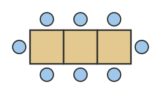

**題目**：方桌一張可以坐 4 人（每邊 1 人）。把方桌排成一長排時，桌子併起來的那一邊不能坐人，上圖是 3 張桌子坐 8 人的排法。照這樣排 8 張桌子，最多可以坐幾人？

**正解**：18 人

**干擾項**

- 32 人　←　4×8，沒有扣掉桌子併起來那一邊
- 16 人　←　2×8，忘了兩端的位子
- 17 人　←　兩端只算了一端

**提示**

1. 先看圖找規律：1 張、2 張、3 張桌子各坐幾人？
2. 每多 1 張桌子，上面多 1 人、下面多 1 人；左右兩端各還有 1 人。
3. 坐的人數＝2×桌數＋2，算 8 張的時候。

**詳解**：排成一長排時，每張桌子的上面和下面各坐 1 人，左右兩端再各坐 1 人。1 張坐 4 人、2 張坐 6 人、3 張坐 8 人……每多 1 張多 2 人，人數＝2×桌數＋2。8 張桌子可以坐 2×8＋2＝18 人。32 是 4×8，沒有扣掉桌子併起來那一邊；16 是 2×8，忘了兩端的 2 個位子；17 只加了一端。

驗算提示：用圖上的 3 張桌子檢查：2×3＋2＝8 人，和圖一樣。

**驗證**：程式重算：2*8+2 ＝ 18（另外驗算了干擾項和詳解裡的 6 個算式）

---

### L17-Q2　用木棒排連在一起的三角形

**附件**

**題目**：用小木棒排成一排連在一起的三角形，相鄰的三角形共用一根木棒；上圖是 4 個三角形用了 9 根木棒。照這樣排 10 個三角形，要用幾根木棒？

**正解**：21 根

**干擾項**

- 30 根　←　每個三角形都算 3 根，沒有扣掉共用的
- 20 根　←　2×10，第 1 個三角形少算了 1 根
- 23 根　←　3＋2×10，增加的次數多算了一次

**提示**

1. 先看圖數一數：1 個、2 個、3 個三角形各用幾根木棒？
2. 第 1 個三角形用 3 根；之後每多 1 個三角形，因為共用一根，只要再加 2 根。
3. 10 個三角形：3＋2×（10－1）。

**詳解**：第 1 個三角形用 3 根木棒，之後每多 1 個三角形，會和前一個共用 1 根，只要再加 2 根。10 個三角形要用 3＋2×（10－1）＝3＋18＝21 根。30 是每個三角形都算 3 根，沒有扣掉共用的；20 是 2×10，第 1 個三角形少算了 1 根；23 是 3＋2×10，增加的次數多算了一次。

驗算提示：用圖上的 4 個三角形檢查：3＋2×（4－1）＝9 根，和圖一樣。

**驗證**：程式重算：3+2*(10-1) ＝ 21（另外驗算了干擾項和詳解裡的 4 個算式）

---

### L17-Q3　座位號碼規律（看餘數）

**題目**：禮堂的座位每排有 6 個，從第 1 排開始，由左到右編號：第 1 排是 1～6 號，第 2 排是 7～12 號，依此類推。小哲拿到 45 號的座位券，他的位子在第幾排的第幾個？

**正解**：第 8 排的第 3 個

**干擾項**

- 第 7 排的第 3 個　←　直接用商當排數，沒注意有餘數就要到下一排
- 第 3 排的第 8 個　←　把排數和位子弄反了（而且一排只有 6 個）
- 第 8 排的第 4 個　←　數位子時多數了一個

**提示**

1. 先找規律：第 1 排最後一號是 6，第 2 排是 12，第 3 排是 18……每排最後一號都是 6 的倍數。
2. 45÷6＝7……3：表示前 7 排已經編完，還多 3 號。
3. 多出來的 3 號在下一排，也就是第 8 排的第幾個？

**詳解**：每排 6 個，45÷6＝7……3，表示前 7 排共 42 個位子已經編完（第 7 排最後是 42 號），還多 3 號，所以 45 號在第 8 排的第 3 個（43、44、45）。第 7 排的第 3 個是直接用商當排數，沒注意有餘數就要到下一排；第 3 排的第 8 個是把排數和位子弄反了，而且一排只有 6 個；第 8 排的第 4 個是位子多數了一個。

驗算提示：第 8 排的號碼是 43～48，45 是其中的第 3 個。

**驗證**：概念判斷題，請人工確認：45＝6×7＋3，前 7 排共 42 號，45 號是第 8 排第 3 個（另外驗算了干擾項和詳解裡的 4 個算式）

---

### L17-Q4　空心方陣的總人數

**附件**

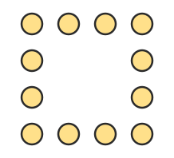

**題目**：運動會表演，同學排成空心的正方形隊伍，四個角都有人；上圖是每邊 4 人、一共 12 人的樣子。如果每邊站 9 人，一共有幾位同學？

**正解**：32 位

**干擾項**

- 36 位　←　9×4，四個角的人重複算了
- 81 位　←　把空心方陣當成實心的 9×9
- 28 位　←　每邊扣掉兩個角（7×4），忘了把 4 個角加回來

**提示**

1. 先看圖：每邊 4 人時，一共有幾人？為什麼不是 4×4＝16？
2. 四個角的人，同時被算在兩條邊上，重複算了。
3. 每邊 9 人：9×4 之後，扣掉重複算的 4 個角。

**詳解**：四個角的人同時站在兩條邊上，如果用 9×4＝36，四個角都被算了兩次，要扣掉 4 人：9×4－4＝32 位。也可以這樣算：每邊不算最後一個角，（9－1）×4＝32 位。36 是四個角重複算了；81 是把空心方陣當成實心的 9×9；28 是每邊扣掉兩個角之後，忘了把 4 個角加回來（7×4）。

驗算提示：用圖檢查：每邊 4 人時，4×4－4＝12 人，數一數圖上剛好 12 人。

**驗證**：程式重算：9*4-4 ＝ 32（另外驗算了干擾項和詳解裡的 5 個算式）

---

### L17-Q5　圖形規律：推算第 n 個圖

**附件**

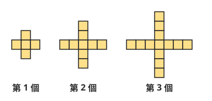

**題目**：用正方形色塊排成十字形，排法的規律如上圖：第 1 個圖用 5 塊、第 2 個圖用 9 塊、第 3 個圖用 13 塊……照這樣排下去，第 12 個圖要用幾塊？

**正解**：49 塊

**干擾項**

- 48 塊　←　直接算 4×12，忘了中間那 1 塊
- 60 塊　←　5×12，以為每個圖都多 5 塊
- 53 塊　←　5＋4×12，增加的次數多算了一次

**提示**

1. 先看圖找規律：從第 1 個到第 2 個、第 2 個到第 3 個，各多了幾塊？
2. 每多一個圖，四條手臂各多 1 塊，一共多 4 塊；第 1 個圖是 5 塊。
3. 第 12 個圖：5＋4×（12－1）。

**詳解**：每往下一個圖，十字的四條手臂各多 1 塊，共多 4 塊：5、9、13……。第 12 個圖是 5＋4×（12－1）＝5＋44＝49 塊（也可以想成：中間 1 塊，加上四條手臂各 12 塊，1＋4×12＝49）。48 是直接 4×12，忘了中間那 1 塊；60 是 5×12，以為每個圖都多 5 塊；53 是 5＋4×12，多加了一次 4。

驗算提示：用第 3 個圖檢查：5＋4×（3－1）＝13 塊，和圖一樣。

**驗證**：程式重算：5+4*(12-1) ＝ 49（另外驗算了干擾項和詳解裡的 6 個算式）

---

### L17-Q6　素養：生活情境（倒推要排幾張桌子）

**題目**：六年一班 30 人要一起吃火鍋。餐廳的方桌一張坐 4 人（每邊 1 人）。桌子排成一長排時，桌子併起來的那一邊不能坐人，只有每張桌子的上下兩邊和最兩端可以坐。最少要排幾張桌子，30 人才坐得下？

**正解**：14 張

**干擾項**

- 8 張　←　只看第 1 張坐 4 人，就以為每張都坐 4 人（30÷4 再進位）
- 15 張　←　30÷2，忘了兩端還有 2 個位子
- 16 張　←　倒推時算錯，多加了 2（（30＋2）÷2）

**提示**

1. 先從小的數目找規律：1 張、2 張、3 張桌子排成一排，各可以坐幾人？
2. 人數＝2×桌數＋2。現在知道人數是 30，要倒回去求桌數。
3. 2×桌數＋2＝30，先扣掉兩端的 2 人，再除以 2。

**詳解**：排成一長排時，1 張坐 4 人、2 張坐 6 人、3 張坐 8 人，人數＝2×桌數＋2。要坐 30 人：2×桌數＋2＝30，桌數＝（30－2）÷2＝14 張，剛好坐 30 人。8 張是只看第 1 張坐 4 人，以為每張都坐 4 人；15 張是 30÷2，忘了兩端還有 2 個位子；16 張是倒推時多加了 2。

驗算提示：14 張桌子：2×14＋2＝30 人，剛好坐得下；13 張只能坐 2×13＋2＝28 人，不夠。

**驗證**：程式重算：(30-2)/2 ＝ 14（另外驗算了干擾項和詳解裡的 5 個算式）

---

### L17-Q7　素養：附件題（列表找規律）

**附件**
| 正方形的個數 | 1 | 2 | 3 | 4 | … | 8 |
|---|---|---|---|---|---|---|
| 牙籤的根數 | 4 | 7 | 10 | 13 | … | ？ |

**題目**：用牙籤排一排連在一起的正方形，正方形的個數和用掉的牙籤根數記錄在上表。表中最後一格的「？」應該是多少？

**正解**：25

**干擾項**

- 32　←　每個正方形都算 4 根，沒有扣掉共用的
- 24　←　3×8，忘了最左邊多的那 1 根
- 28　←　從第 4 個的 13 根往後加了 5 次 3，次數算錯

**提示**

1. 先讀表格：正方形每多 1 個，牙籤多幾根？
2. 4、7、10、13……每次多 3 根；第 1 個用 4 根。
3. 第 8 個：4＋3×（8－1），或從第 4 個的 13 根再加 4 次 3。

**詳解**：每多 1 個正方形，會和前一個共用 1 根牙籤，只要再加 3 根：4、7、10、13……。第 8 個是 4＋3×（8－1）＝4＋21＝25 根（也可以寫成 3×8＋1＝25）。32 是每個正方形都算 4 根；24 是 3×8，忘了最左邊多的那 1 根；28 是從第 4 個的 13 根往後加了 5 次 3，第 4 個到第 8 個只要加 4 次。

驗算提示：用表上的第 4 個檢查：3×4＋1＝13，和表格一樣。

**驗證**：程式重算：4+3*(8-1) ＝ 25（另外驗算了干擾項和詳解裡的 6 個算式）

---
